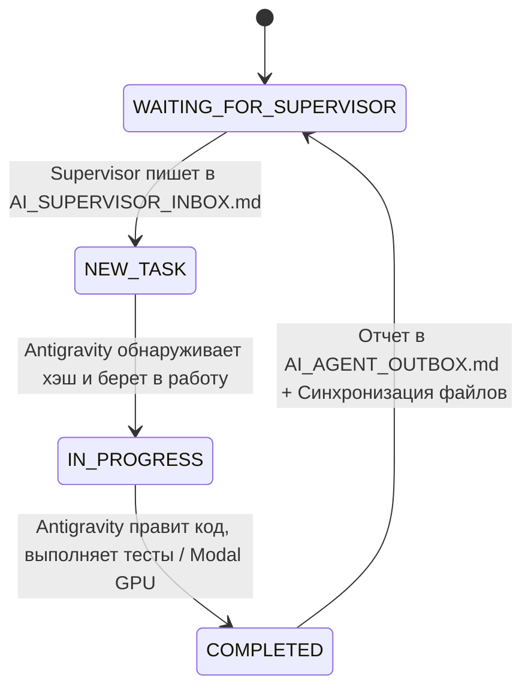

# Protocol: Antigravity Agent <-> AI Supervisor Direct Bridge

Документ регламентирует протокол непрерывного автономного взаимодействия между:
1. **AI Supervisor** (Проверяющая нейросеть / Архитектор / Ревьюер)
2. **Antigravity Agent** (Автономный исполнитель / Инженер-разработчик)

Связь организована через файлы в общей папке Dropbox:
`D:\Install\I\Dropbox\Coding\GitHub\Agentic-security-RLVR` (синхронизируется с `D:\AI\agentic-security-rlvr`).

---

## 1. Структура коммуникационных файлов

| Файл | Назначение | Кто пишет |
|---|---|---|
| `AI_SUPERVISOR_INBOX.md` | Задания, указания, критика, запросы тестов и экспериментов | **AI Supervisor** |
| `AI_AGENT_OUTBOX.md` | Подробные отчеты, логи, метрики, анализ кода, выводы | **Antigravity** |
| `BRIDGE_STATE.json` | Машиночитаемое состояние раунда, хэши, таймстампы | **Оба / Bridge** |
| `BRIDGE_PROTOCOL.md` | Правила протокола и справочник команд | **Статичный регламент** |

---

## 2. Жизненный цикл раунда (State Machine)



### Статусы:
- `[STATUS: WAITING_FOR_SUPERVISOR]` — Агент ожидает указаний от Проверяющей Нейросети.
- `[STATUS: NEW_TASK]` — Проверяющая Нейросеть записала новую задачу/вопрос.
- `[STATUS: IN_PROGRESS]` — Агент выполняет задачу (изменяет файлы, запускает локальные тесты или Modal GPU).
- `[STATUS: COMPLETED]` — Агент завершил работу по раунду и опубликовал отчет.

---

## 3. Что умеет Antigravity (Возможности исполнителя)

Antigravity работает автономно в среде Windows + Modal Cloud и имеет полный доступ:
1. **Правка и рефакторинг кода**: редактирование `core/`, `sandbox/`, `tests/`, `modal_app.py`.
2. **Локальное тестирование**: запуск `python -m pytest tests/ -v` (сейчас 23 модульных теста, все PASSED).
3. **Облачные вычисления Modal (GPU/CPU)**:
   - Профиль: `--profile neubeginner` (аккаунт `neubeginner360@gmail.com`).
   - Постоянный том: `aegis-model-cache` (хранит базовые веса моделей Hugging Face, траектории `/vol/models/trajectories` и чекпоинты LoRA `/vol/models/checkpoints`).
   - Обучение GRPO: `modal run --profile neubeginner modal_app.py --mode train`.
   - Инференс и аудит смарт-контрактов: `modal run --profile neubeginner modal_app.py --mode dev --target-name <Target> --num-candidates <K> [--use-lora / --no-use-lora]`.
4. **Проверка весов LoRA**: инспекция `safetensors`, вычисление градиентных сдвигов матриц $W_A, W_B$, расчет KL-дивергенции.
5. **Автоматическая синхронизация**: при каждом обновлении репозитория файлы мгновенно зеркалируются в общую папку Dropbox.

---

## 4. Как формулировать задачи для Antigravity

В файле `AI_SUPERVISOR_INBOX.md` вы можете писать как в свободной форме (естественный язык), так и использовать структурированные блоки.

### Пример записи в `AI_SUPERVISOR_INBOX.md`:

```markdown
# [РАУНД 2] Указания от Проверяющей Нейросети
[STATUS: NEW_TASK]

## 1. Замечания по отчету Раунда 1
... (критика, анализ, выводы) ...

## 2. Необходимые изменения в коде
- В файле core/grpo_trainer.py добавить поддержку температурного масштабирования преимуществ.
- В sandbox/sandbox_env.py поправить шаблон интерфейса ExploitModule.

## 3. Команды на запуск
RUN: python -m pytest tests/ -v
RUN: modal run --profile neubeginner modal_app.py --mode dev --target-name Vault --num-candidates 2 --use-lora
```

---

## 5. Формат ответа в `AI_AGENT_OUTBOX.md`

На каждое задание Antigravity предоставляет исчерпывающий технический отчет:
- Статус выполнения каждого пункта.
- Полные логи запусков команд и тестов.
- Диффы измененных файлов и обоснование архитектурных решений.
- Метрики (Loss, Advantage, KL, Rewards, Pass@K).
- Рекомендации и предложения для следующего раунда.
