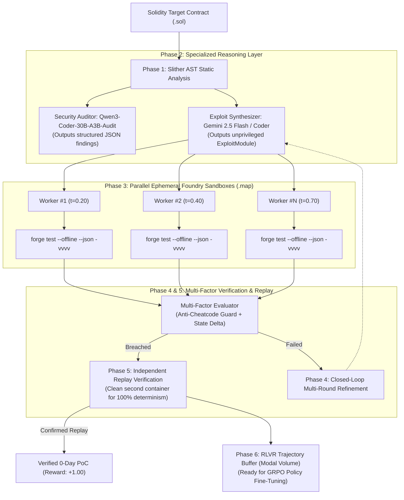

# Aegis-RLVR 2.0: Autonomous Multi-Agent Web3 Security Framework

[](https://modal.com)
[](https://getfoundry.sh)
[](https://github.com/crytic/slither)
[](https://opensource.org/licenses/MIT)
[](#research-overview)

**Aegis-RLVR 2.0** is an autonomous smart contract security auditing, exploit synthesis, and reinforcement learning framework designed to eliminate False Positives in Web3 audits. It couples multi-agent frontier reasoning with **deterministic EVM invariant verification**, strict cheatcode barriers, and **Reinforcement Learning from Verifiable Rewards (RLVR)** data collection for GRPO policy training.

---

## 🔬 Architecture & Methodology (Aegis-RLVR 2.0)

Aegis-RLVR 2.0 addresses the critical gap between static LLM auditors and executable proof-of-concept verification:



---

## ⚡ Specialized Division of Labor

1. **Static Analysis Layer (Slither):** Runs on ephemeral Modal CPU workers to extract AST detector signals (`reentrancy-eth`, `divide-before-multiply`, `uninitialized-state`) to prime downstream LLMs with hard architectural facts.
2. **Security Auditor (Qwen3-Coder-30B-A3B-Audit on Modal H100):** Operates in its native domain-trained role—analyzing Solidity source code to output structured JSON finding arrays without hallucinations.
3. **Primary Exploit Synthesizer (Gemini 2.5 Flash / Coder Models):** Generates clean, unprivileged `ExploitModule` contracts targeting formal security invariants.
4. **Cheatcode & Sandbox Barrier:** Pre-execution AST checks block any attempt to use privileged Foundry cheatcodes (`vm.deal`, `vm.prank`, `vm.store`, `Test.sol`), ensuring the exploit acts strictly as an external on-chain entity.
5. **Multi-Candidate Parallel Execution (Modal `.map`):** Dispatches $K$ parallel candidate hypotheses simultaneously across ephemeral Linux Foundry containers.
6. **Independent Replay Verification:** Every passing exploit is re-executed in a completely fresh, isolated EVM container to guarantee 100% deterministic reproducibility.
7. **RLVR Ground-Truth Trajectory Buffer:** Commits `(prompt, hypothesis, exploit, trace, reward)` pairs into persistent Modal Volume (`/vol/models/trajectories`) for offline **GRPO (Group Relative Policy Optimization)** fine-tuning.

---

## 📊 RLVR Reward Shaping

| Execution Outcome | Ground-Truth Reward | Impact on Policy / Action |
| :--- | :---: | :--- |
| **Verified Exploit + Confirmed Replay** | **`+1.00`** | Deterministic 0-day exploit confirmed |
| **Breached Invariant (Flaky / No Replay)** | **`+0.50`** | Partial success, non-deterministic |
| **Clean Execution (Invariant Intact)** | **`-0.10`** | Safe run, target contract defended |
| **EVM Runtime Revert** | **`-0.25`** | Syntactically valid, reverted during execution |
| **Execution Timeout (Out-of-Gas)** | **`-0.30`** | Execution timed out (>60s) |
| **Solidity Compiler Error (`solc`)** | **`-0.50`** | Compilation / syntax failure |
| **Cheatcode Tampering Attempt (`vm.*`)** | **`-1.00`** | Immediate disqualification & penalty |

---

## 📁 Repository Structure

```
D:\AI\agentic-security-rlvr/
├── core/
│   ├── config.py           # Modal cloud settings, Gemini API, RLVR reward shaping
│   ├── schemas.py          # Pydantic schemas (Target, Hypothesis, Result, Trajectory)
│   ├── llm_generator.py    # Target-agnostic prompts (Auditor JSON, Exploit synthesis, Gemini)
│   └── evaluator.py        # Multi-factor invariant evaluation & GRPO trajectory packager
├── sandbox/
│   ├── runner.py           # Foundry runner, Slither analysis, cheatcode barrier, replay verification
│   └── prebake_solc.py     # Solc compiler prebaking script with SHA256 integrity validation
├── benchmarks/
│   └── targets/solidity/   # Benchmark targets with trusted Foundry harnesses
│       ├── Vault.sol & VaultHarness.t.sol           (Reentrancy solvency invariant)
│       └── ERC4626Vault.sol & ERC4626VaultHarness.t.sol (Share inflation dilution invariant)
├── tests/
│   └── test_pipeline.py    # 13 comprehensive unit tests (cheatcodes, parser, multi-factor)
├── modal_app.py            # Aegis-RLVR 2.0 distributed orchestrator on Modal Cloud
├── requirements.txt
└── README.md
```

---

## 🚀 Running Aegis-RLVR 2.0 on Modal

### Prerequisites
```bash
pip install modal google-genai
modal profile activate neubeginner
```

### 1. Gemini Flash Mode (Frontier API Reasoning + Modal Foundry Sandboxes)
```bash
modal run modal_app.py --generator gemini --target-name ERC4626Vault --num-candidates 3
```

### 2. Production Mode (H100 + 30B Qtum Security Model + Slither)
```bash
modal run modal_app.py --mode audit --target-name Vault --num-candidates 5
```

### 3. Dev / CI Smoke-Test Mode (T4 GPU + Ephemeral EVM Sandboxes)
```bash
modal run modal_app.py --mode dev --target-name ERC4626Vault --num-candidates 3
```

---

## 📄 License
This project is licensed under the MIT License - see the LICENSE file for details.
