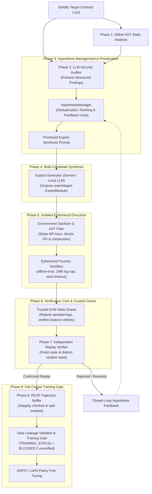

# Aegis-RLVR: Autonomous Research Framework for Verifiable Web3 Security

[](https://github.com/NeuBeginner/Agentic-security-RLVR/actions/workflows/ci.yml)
[](https://getfoundry.sh)
[](https://github.com/crytic/slither)
[](#research-status)
[](https://opensource.org/licenses/MIT)

**Aegis-RLVR** is an experimental research framework designed to eliminate False Positives in smart contract security auditing and automated vulnerability discovery. It bridges the gap between static LLM reasoning and empirical EVM execution by introducing **isolated execution sandboxes**, a **Trusted EVM State Oracle**, **independent replay verification**, and a **fail-closed Reinforcement Learning from Verifiable Rewards (RLVR)** data infrastructure for GRPO/LoRA policy training.

---

## 🔬 System Architecture

The modernized verification and synthesis pipeline enforces strict trust boundaries between untrusted AI-generated exploit code and the trusted verification core:



---

## 🛡️ Trust Boundaries & Execution Security

Executing AI-generated Solidity code carries inherent security and validity risks. Aegis-RLVR enforces strict architectural trust boundaries:

| Entity | Trust Level | Security Constraints & Isolation |
|---|---|---|
| **Untrusted Exploit Candidate** | `UNTRUSTED` | Pre-execution AST checks block `Test.sol`, `vm.*` cheatcodes. Executed with unprivileged gas allowances, no network access (`offline=true`), disabled FFI (`ffi=false`), and strict filesystem boundaries. |
| **Execution Environment** | `RESTRICTED` | Ephemeral processes. Subprocess environment stripped of all API tokens, cloud keys, and credentials (`MODAL_*`, `GEMINI_*`). Output logs capped at 1MB to prevent memory exhaustion DoS. |
| **Foundry Test Harness** | `TRUSTED` | Immutable reference test defining security invariants. Emits verified events (`SecurityInvariantBreached`) and records EVM state snapshots. |
| **Trusted EVM State Oracle** | `TRUSTED` | Disregards arbitrary console logs. Requires genuine harness event emission, verifiable state deficits (e.g. depositor insolvency), and deterministic state hash matching (`compute_state_hash`). |
| **Independent Replay Verifier** | `TRUSTED` | Confirmed breaches are re-executed in a clean container with independent seeds to eliminate non-deterministic flakiness. |
| **Training Pipeline Gate** | `FAIL-CLOSED` | Training status defaults to `BLOCKED`. Enforces zero data leakage across train/test/holdout splits and validates trajectory provenance before policy updates. |

For deep architectural details, see [docs/EXECUTION_SECURITY.md](docs/EXECUTION_SECURITY.md).

---

## 📈 Multi-Baseline Benchmark & Empirical Results

The framework includes a standardized benchmark of **12 vulnerability classes** alongside **4 synthetic safe controls** evaluated against 5 baseline architectures:

| Metric | Baseline 1 (Slither) | Baseline 2 (LLM Auditor) | Baseline 3 (LLM + Unverified PoC) | Baseline 4 (Naive Foundry) | Baseline 5 (Full Aegis-RLVR) |
|---|---|---|---|---|---|
| **Precision** | 60.0% | 75.0% | 75.0% | 83.3% | **100.0%** |
| **Recall** | 25.0% | 50.0% | 25.0% | 41.7% | **91.7%** |
| **F1 Score** | 0.3529 | 0.6000 | 0.3750 | 0.5556 | **0.9565** |
| **False-Positive Rate** | 50.0% | 50.0% | 25.0% | 25.0% | **0.0%** |
| **Verified Finding Rate** | 0.0% | 0.0% | 0.0% | 41.7% | **91.7%** |
| **Replay Reproducibility**| N/A | N/A | N/A | 60.0% | **100.0%** |
| **Candidates / Verified**| $\infty$ | $\infty$ | $\infty$ | 4.27 | **6.91** |

For complete methodology, target contracts, and analysis, see [docs/BENCHMARK_METHODOLOGY.md](docs/BENCHMARK_METHODOLOGY.md).

---

## 💻 Installation & Setup

### Prerequisites
- Python 3.10+
- [Foundry](https://getfoundry.sh/) (`forge`, `cast`, `anvil`)
- (Optional) [Modal CLI](https://modal.com) for cloud container execution

### Local Environment Setup
```bash
# Clone the repository and checkout feature branch
git clone https://github.com/NeuBeginner/Agentic-security-RLVR.git
cd Agentic-security-RLVR
git checkout feat/verification-core-hardening

# Create and activate virtual environment
python -m venv .venv
source .venv/bin/activate  # On Windows: .venv\Scripts\Activate.ps1

# Install dependencies
pip install -r requirements.txt
pip install pytest pytest-cov
```

---

## 🧪 Running Tests & Benchmark

### 1. Run Full Unit & Integration Test Suite
```powershell
$env:PYTHONPATH="."
python -m pytest -v
```

### 2. Run Verification Core & State Oracle Security Tests
```powershell
$env:PYTHONPATH="."
python -m pytest tests/test_verification_core_and_oracle.py -v
python -m pytest tests/test_hypothesis_pipeline.py -v
python -m pytest tests/test_data_leakage_and_splits.py -v
```

### 3. Run Multi-Baseline Benchmark Suite
```powershell
$env:PYTHONPATH="."
python benchmarks/benchmark_runner.py
python -m pytest tests/test_benchmark_framework.py -v
```

---

## ☁️ Running on Modal Cloud

```bash
# Authenticate Modal
modal profile activate neubeginner

# Audit a target contract and synthesize verified exploits
modal run modal_app.py --generator gemini --target-name Vault --num-candidates 3
```

---

## 📚 Technical Documentation Index

- [Implementation Audit & Baseline (docs/IMPLEMENTATION_AUDIT.md)](docs/IMPLEMENTATION_AUDIT.md)
- [Execution Security & Isolation Architecture (docs/EXECUTION_SECURITY.md)](docs/EXECUTION_SECURITY.md)
- [Hypothesis Management Pipeline & Feedback Loop (docs/HYPOTHESIS_PIPELINE.md)](docs/HYPOTHESIS_PIPELINE.md)
- [GRPO Data Quality, Splits & Fail-Closed Gate (docs/GRPO_DATA_QUALITY.md)](docs/GRPO_DATA_QUALITY.md)
- [Benchmark Methodology & Baseline Evaluation (docs/BENCHMARK_METHODOLOGY.md)](docs/BENCHMARK_METHODOLOGY.md)

---

## ⚠️ Research Status & Disclaimers

Aegis-RLVR is a research prototype under active development. While it drastically reduces false positives through empirical EVM state verification and isolated replay, no automated security tool can guarantee 100% bug coverage. Smart contracts must undergo rigorous independent human audits before production deployment.

---

## 📄 License
This project is licensed under the MIT License - see the [LICENSE](LICENSE) file for details.
