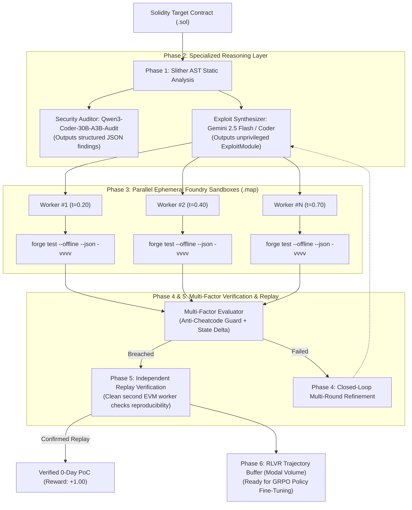

# Aegis-RLVR 2.0: Autonomous Multi-Agent Web3 Security Framework

[](https://modal.com)
[](https://getfoundry.sh)
[](https://github.com/crytic/slither)
[](https://opensource.org/licenses/MIT)
[](#research-overview)

**Aegis-RLVR 2.0** is an autonomous smart contract security auditing, exploit synthesis, and reinforcement learning framework designed to reduce false positives in Web3 audits. It couples multi-agent frontier reasoning with **deterministic EVM invariant verification**, strict cheatcode barriers, and **Reinforcement Learning from Verifiable Rewards (RLVR)** data collection for GRPO policy training.

---

## 🔬 Architecture & Methodology (Aegis-RLVR 2.0)

Aegis-RLVR 2.0 addresses the critical gap between static LLM auditors and executable proof-of-concept verification:



---

## 📊 Aegis-EVM-Bench (56 Verified Contracts) & Benchmark Evidence

The repository packages **Aegis-EVM-Bench**, a 56-contract deterministic Solidity verification corpus with cryptographic train/test isolation (`SHA-256 overlap = 0`):
- **Frozen `test` split (16 targets)**: 12 vulnerable DeFi targets + 4 `SYNTHETIC_SAFE_CONTROL` contracts (`benchmarks/benchmark_dataset.json`, `benchmarks/targets/solidity/`).
- **Disjoint `train` split (40 targets)**: 40 DeFi vulnerability classes (`benchmarks/train_dataset.json`, `benchmarks/targets/solidity_train/`).
- **Dual-Loop Patch Pilots (5 targets)**: trusted functional regression suites (`benchmarks/targets/solidity_train_functional/`) for Red+Blue RLVR.

> Note: This repository reports verified `baseline_5` progression (`cycle4`–`cycle8`) and controlled `L4` mini-GRPO + refinement experiments rather than a full 5-baseline comparative sweep. Every figure below is backed by retained execution artifacts.

### 1. Frozen `test` Split (`baseline_5`, 16 Targets: 12 Vulnerable + 4 Safe Controls)

| Cycle | Run ID | TP / Vuln | TN / Safe | FP | Recall | Precision | F1 | Replay Rate |
| :--- | :--- | :---: | :---: | :---: | :---: | :---: | :---: | :---: |
| `cycle4` | `run_1794945167_fdb1b2d` | 3 / 12 | 4 / 4 | 0 | 25.00% | 100.00% | 0.4000 | 100.00% |
| `cycle5` | `run_1794998302_d2d05e5` | 5 / 12 | 4 / 4 | 0 | 41.67% | 100.00% | 0.5883 | 100.00% |
| `cycle6` | `run_1795014999_12a1178` | 5 / 12 | 4 / 4 | 0 | 41.67% | 100.00% | 0.5883 | 100.00% |
| `cycle7` | `run_1795023810_524533d` | 6 / 12 | 4 / 4 | 0 | 50.00% | 100.00% | 0.6667 | 100.00% |
| `cycle8` | `run_1795027271_8c19acf` | **6 / 12** | **4 / 4** | **0** | **50.00%** | **100.00%** | **0.6667** | **100.00%** |

Consolidated closure validation (`benchmarks/evidence/consolidated_closure_validation_evidence.json`): **21/21 checks PASSED**.

### 2. Controlled L4 Mini-GRPO + Verifier-Guided Refinement (`Qwen/Qwen3-4B-Instruct-2507`, `DEV_EVAL_8`, 32 Rollouts)

Trained on `poc_40t_train32` (32 disjoint train contracts, `checkpoint-step-69`, 3 epochs × 23 informative groups, `lr=1e-5`, `0 INFRA_ERROR`) and evaluated on 8 held-out `DEV_EVAL_8` targets (`benchmarks/evidence/grpo_poc/poc_40t_dev_3way_summary.json`):

| Stage (`DEV_EVAL_8`, 8 contracts × `G=4`) | `FORMAT_ERR` | Valid EVM (`EXP+REV+SAFE`) | `EXPLOIT_CONFIRMED` (Pass@1) | Mean Reward v2 |
| :--- | :---: | :---: | :---: | :---: |
| 1. Pre-GRPO Base 4B (`R0`) | 13 / 32 (40.6%) | 18 / 32 (56.25%) | 2 / 32 (6.25%) | `-0.1922` |
| 2. Post-GRPO `step-69` (`R0`) | **2 / 32 (6.25%)** | 24 / 32 (75.00%) | 3 / 32 (9.38%) | `-0.1438` |
| 3. Post-GRPO `step-69` + Verifier `R1` | 3 / 32 (9.38%) | **26 / 32 (81.25%)** | **5 / 32 (15.63%, 2.5×)** | **`-0.0641`** |

---

## 🛡️ Dual-Loop «Exploit → Verified Patch» (Red + Blue RLVR)

`core/patch_verifier.py` and `sandbox/patch_runner.py` extend the framework with a deterministic **Blue-team patch verification loop** (`BlueReward` spec `1.0.0`):
1. **Static & Anti-Cheatcode Gate**: enforces `contract <TargetName>`, blocks `vm.*` / `forge-std` / `selfdestruct` (`-1.00`), and rejects no-op patches (`-0.35`).
2. **Red Precondition Sanity Check**: fail-closed verification that the Red `ExploitModule` breaches the unpatched contract.
3. **Functional Regression Gate (`*Functional.t.sol`)**: catches trivial bricking patches (e.g. `revert()`) as `FUNCTIONAL_REGRESSION` (`-0.25`).
4. **Security Gate (`*Harness.t.sol`)**: confirms the Red exploit is blocked (`EXPLOIT_STILL_SUCCEEDS` = `-0.10`).
5. **Independent Fresh-EVM Replay**: confirms deterministic `PATCH_VERIFIED` (`+1.00` vs `+0.50` without replay).

Verified locally in real Foundry across 5 pilot contracts × 4 scenarios (`tests/test_patch_verifier.py`).

---

## 💻 Local Quickstart (`$0.00` Local Foundry CLI)

```bash
# 1. Inspect the 56-contract corpus & train/test SHA-256 isolation
python -m benchmarks.aegis_evm_bench inspect

# 2. Render verified benchmark & GRPO progression leaderboards
python -m benchmarks.aegis_evm_bench leaderboard

# 3. Evaluate external ExploitModule submissions locally
python -m benchmarks.aegis_evm_bench evaluate --submissions path/to/subs.json --split test

# 4. Run Dual-Loop Red+Blue patch verification tests (unit + real Foundry)
python -m pytest -v tests/test_patch_verifier.py tests/test_aegis_evm_bench.py
```

---

## ⚡ Specialized Division of Labor

1. **Static Analysis Layer (Slither):** Runs on ephemeral Modal CPU workers to extract AST detector signals (`reentrancy-eth`, `divide-before-multiply`, `uninitialized-state`) to prime downstream LLMs with hard architectural facts.
2. **Security Auditor (Qwen3-Coder-30B-A3B-Audit on Modal H100):** Operates in its native domain-trained role—analyzing Solidity source code to output structured JSON finding arrays without hallucinations.
3. **Primary Exploit Synthesizer (Gemini 2.5 Flash / Coder Models):** Generates clean, unprivileged `ExploitModule` contracts targeting formal security invariants.
4. **Cheatcode & Sandbox Barrier:** Pre-execution AST checks block any attempt to use privileged Foundry cheatcodes (`vm.deal`, `vm.prank`, `vm.store`, `Test.sol`), ensuring the exploit acts strictly as an external on-chain entity. The barrier also covers **verification-channel hijacks**: importing the Foundry test framework or the console library, or declaring a public `test*` entrypoint, is rejected as a security violation.
5. **Multi-Candidate Parallel Execution (Modal `.map`):** Dispatches $K$ parallel candidate hypotheses simultaneously across ephemeral Linux Foundry containers.
6. **Independent Replay Verification:** Every candidate that passes the trusted harness can be re-executed in a fresh EVM worker; replay is an empirical reproducibility check, not a mathematical guarantee.
7. **RLVR Ground-Truth Trajectory Buffer:** Commits `(prompt, hypothesis, exploit, trace, reward)` pairs into persistent Modal Volume (`/vol/models/trajectories`) for offline **GRPO (Group Relative Policy Optimization)** fine-tuning.

---

## 📊 RLVR Reward Shaping (Specification 2.0.0)

| Execution Outcome | Ground-Truth Reward | Impact on Policy / Action |
| :--- | :---: | :--- |
| **Verified Exploit + Confirmed Replay** | **`+1.00`** | Deterministic 0-day exploit confirmed |
| **Breached Invariant (Flaky / No Replay)** | **`+0.50`** | Partial success, non-deterministic |
| **Infrastructure / Harness Error** | **`0.00`** | Not the model's fault — excluded from GRPO groups |
| **Clean Execution (Invariant Intact)** | **`-0.10`** | Safe run, target contract defended |
| **EVM Runtime Revert** | **`-0.25`** | Syntactically valid, reverted during execution |
| **Execution Timeout (Out-of-Gas)** | **`-0.30`** | Execution timed out (>60s) |
| **Malformed Output / Interface Mismatch** | **`-0.35`** | Cheap mechanical fix (name/shape), strictly closer to success than a compile failure |
| **Solidity Compiler Error (`solc`)** | **`-0.50`** | Compilation / syntax failure — requires real semantic repair |
| **Cheatcode Tampering Attempt (`vm.*`)** | **`-1.00`** | Immediate disqualification & penalty |

> Format failures and compilation failures are deliberately **not** equal: the interface
> mismatch is mechanically cheap to repair, while a compile error means the exploit
> logic itself needs rework. Equal rewards would erase that gradient.

### Reward components — every reward is fully attributable

The total is decomposed into five **evidence-scoped components** plus one outcome
penalty (`core/reward_shaping.py`):

```
total = sum(component credits) + outcome penalty
```

| Component | Weight | Trusted evidence class |
| :--- | :---: | :--- |
| `generation` | `+0.05` | the static, deterministic format gate accepted the candidate |
| `compilation` | `+0.10` | the trusted compiler (`solc`/`forge`) accepted it |
| `verification` | `+0.10` | the candidate executed in the EVM without reverting |
| `invariant` | `+0.25` | the **trusted harness oracle** confirmed the invariant breach |
| `replay` | `+0.50` | an **independent** fresh-EVM run reproduced the same verdict |

The penalty table is calibrated so that the totals above stay **byte-compatible** with
the legacy ladder — the observable reward does not change, but every point is now
traceable to exactly one piece of evidence.

**No double counting.** Each component belongs to exactly one evidence class and is
credited at most once: the `invariant` credit comes from the trusted verdict of the
current execution, the `replay` credit only from the verdict of a **second,
independent** execution.

**Fail-closed.** An unknown or untrusted outcome never produces a positive reward for a
confirmed vulnerability.

### Trusted evidence — the reward is never more trustworthy than its source

The breach verdict comes from the **structured test result of the immutable,
repository-owned harness suite** (`test/<Target>Harness.t.sol`), never from the logs:

```
status == "Success"                          -> BREACH      (harness returned normally)
status == "Failure" + "EXPLOIT_FAILED: ..."  -> NO_BREACH   (exploit ran, invariant held)
status == "Failure" + other reason           -> EXEC_REVERT (the exploit call reverted)
no trusted suite / no result                 -> UNKNOWN     (fail-closed)
```

The previous implementation grepped the logs for `[INVARIANT_BREACHED`. That marker is
printed by the **model-controlled exploit itself**, so it was never evidence. The marker
is now kept for diagnostics only. In addition, the candidate can no longer reach the
verification channel at all: importing the Foundry test framework, importing the console
library, or declaring a public `test*` entrypoint are rejected as security violations
before Foundry is even invoked.

The harness contract the verdict relies on is *asserted*, not assumed —
`tests/test_harness_contract.py` fails if a harness ever stops returning normally on
the breach path.

### Reward specification version in the provenance

Every verdict and every trajectory carries `reward_spec_version` plus the full
`reward_components` attribution. GRPO groups include the specification version in their
identity, so **trajectories scored by incompatible reward specifications are never
merged into one advantage group**. `verify_reward_reproducibility()` re-derives a stored
reward from its stored components (fail-closed when the attribution is missing).

---

## 🧩 Mechanical Contract-Name Normalization

The verification harness imports the candidate as `contract ExploitModule`. Models
frequently emit a descriptive name instead (`VaultAttack`, `ReentrancyDrain`, ...),
which used to reject the candidate **before** Foundry ever ran — so it could never
produce a verifiable reward, and the group received a uniform penalty with zero
learning signal.

`normalize_exploit_contract_name()` now repairs exactly that case before validation.
The repair is **proof-based and fail-closed**:

- Renames the declaration and **only proven references** to it (self-references, type
  casts, `new`, inheritance, static member access).
- Declines the repair when the name is ambiguous: a second top-level contract, a
  same-named `interface` / `library` / `struct` / `event` / `function` / state variable /
  parameter, an import binding the same name, or an inner-scope shadow. The file then
  stays **byte-identical** — an unrelated declaration is never rewritten.
- Rewrites only identifier tokens — string literals and comments are never altered.
- Never renames symbols inside `import` statements, never renames member names
  (`x.VaultAttack`).
- Is idempotent: running it on normalized code is a no-op.
- The strict validator stays strict and is still used directly for diagnostics.
- Every repair is recorded on the payload (`contract_name_normalized`,
  `original_contract_name`, `contract_normalization_reason`) so it remains auditable,
  while `full_completion_text` keeps the model's **original** output so token lineage
  and the trained completion stay byte-identical.

The normalized contracts are compiled with a real `solc 0.8.20` in the test suite
(`tests/test_contract_normalization_v2.py`).

Set `ENABLE_CONTRACT_NAME_NORMALIZATION = False` in `core/config.py` to restore the
previous behaviour.

---

## 📁 Repository Structure

```
D:\AI\agentic-security-rlvr/
├── core/
│   ├── config.py           # Modal cloud settings, Gemini API, RLVR reward shaping
│   ├── schemas.py          # Pydantic schemas (Target, Hypothesis, Result, Trajectory)
│   ├── evidence.py         # Trusted evidence contract (harness verdicts, anti-forgery rules)
│   ├── reward_shaping.py   # Reward Specification 2.0.0 (components, penalties, versions)
│   ├── llm_generator.py    # Target-agnostic prompts, Solidity lexer, contract-name normalization
│   ├── evaluator.py        # Multi-factor invariant evaluation & GRPO trajectory packager
│   ├── grpo_trainer.py     # GRPO primitives, advantage computation, group spread diagnostics, LoRA setup
│   ├── candidate_lifecycle.py # Candidate ranking, replay selection, finalized trajectory construction
│   ├── ab_evaluator.py     # Audit-grade A/B metric recomputation from raw candidate records
│   └── dropbox_bridge.py   # Supervisor<->agent file bridge (Dropbox), env-driven workspace paths
├── sandbox/
│   ├── runner.py           # Foundry runner, Slither analysis, cheatcode barrier, replay verification
│   └── prebake_solc.py     # Solc compiler prebaking script with SHA256 integrity validation
├── benchmarks/
│   ├── raw_ab_candidates.json   # Raw candidate records used for A/B metric recomputation
│   └── targets/solidity/   # Benchmark targets with trusted Foundry harnesses
│       ├── Vault.sol & VaultHarness.t.sol           (Reentrancy solvency invariant)
│       └── ERC4626Vault.sol & ERC4626VaultHarness.t.sol (Share inflation dilution invariant)
├── tests/                  # 196 unit tests (lexer, evaluator, lifecycle, GRPO integrity,
│                            # provenance isolation, security gates, A/B recomputation,
│                            # normalization v2 + real solc compile tests, reward shaping 2.0.0,
│                            # trusted harness contract)
├── modal_app.py            # Aegis-RLVR 2.0 distributed orchestrator on Modal Cloud
├── audit_trajectories.bat  # Read-only trajectory audit helper for Windows
├── requirements.txt
└── README.md
```

---

## 🚀 Running Aegis-RLVR 2.0 on Modal

### Prerequisites
```bash
pip install modal google-genai
modal profile activate neubeginner
```

### 1. Gemini Flash Mode (Frontier API Reasoning + Modal Foundry Sandboxes)
```bash
modal run modal_app.py --generator gemini --target-name ERC4626Vault --num-candidates 3
```

### 2. Production Mode (H100 + 30B Qtum Security Model + Slither)
```bash
modal run modal_app.py --mode audit --target-name Vault --num-candidates 5
```

### 3. Dev / CI Smoke-Test Mode (T4 GPU + Ephemeral EVM Sandboxes)
```bash
modal run modal_app.py --mode dev --target-name ERC4626Vault --num-candidates 3
```

### 4. Read-Only Trajectory Audit (no training, no checkpoint writes)
```bash
modal run modal_app.py --mode audit-trajectories
# or on Windows: audit_trajectories.bat
```
Reports the partition/provenance breakdown of the persistent trajectory volume and
the exact count of records eligible for GRPO. The audit and the production loader
share one eligibility evaluator, so their numbers cannot drift apart.

### 5. Diagnostic Forward Pass (loss only, no optimizer step)
```bash
modal run modal_app.py --mode diagnostic-forward
```

### 6. Harness Control Tests (real Foundry execution)
```bash
modal run modal_app.py --mode test-harness
```

> GRPO training (`--mode train`) is blocked by an explicit fail-closed gate while the
> AI Supervisor's acceptance criteria are open.

---

## 🔍 GRPO Signal Diagnostics

`diagnose_group_spread()` reports whether the accumulated trajectories can actually
teach the model anything:

```python
from core.grpo_trainer import diagnose_group_spread, group_rollouts_by_prompt

spread = diagnose_group_spread(group_rollouts_by_prompt(trajectories))
# {'total_groups': 12, 'degenerate_groups': 12, 'informative_groups': 0, ...}
```

A group whose rollouts all received the same reward yields **all-zero advantages**
and therefore exactly zero gradient. `train_grpo_epochs()` now fails closed when
every group is degenerate, instead of silently reporting a meaningless loss.

Group identity also carries the **reward specification version** (`reward_spec_version`),
so trajectories scored by incompatible specifications never share one advantage group:

```python
from core.grpo_trainer import verify_reward_reproducibility

verify_reward_reproducibility(trajectory)
# {'reward_spec_version': '2.0.0', 'reproducible': True, 'recomputed_total': 1.0, ...}
```

---

## 📄 License
This project is licensed under the MIT License - see the LICENSE file for details.
