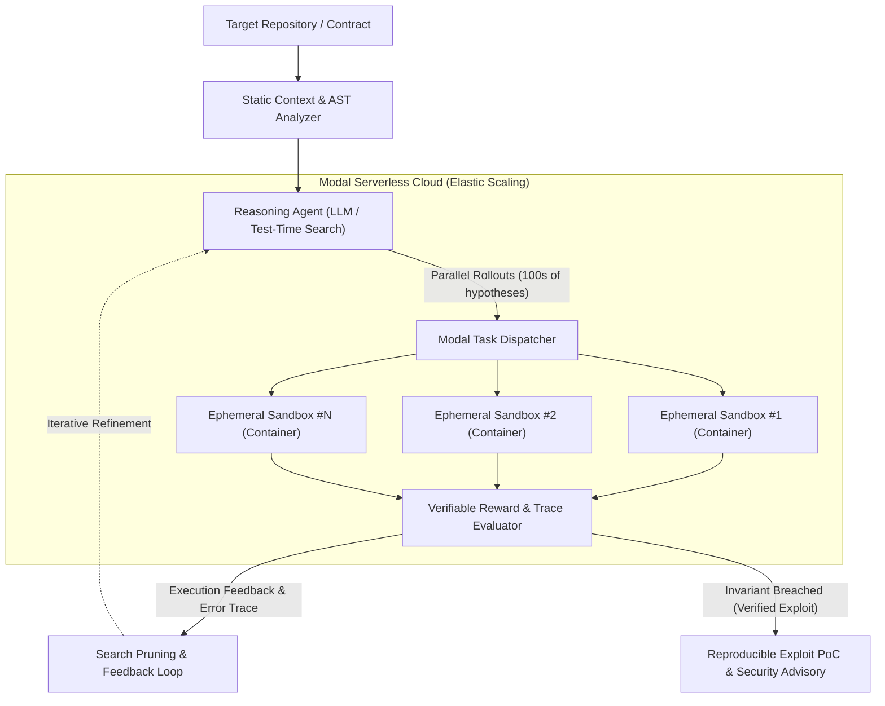

# Aegis-RLVR: Scalable Neuro-Symbolic Agentic Fuzzing & Exploit Verification

[](https://modal.com)
[](https://opensource.org/licenses/MIT)
[](#research-overview)

**Aegis-RLVR** is an autonomous security research framework that combines Large Language Model (LLM) reasoning with **Reinforcement Learning from Verifiable Rewards (RLVR)** and distributed, isolated serverless sandboxes to discover, synthesize, and rigorously verify software and smart contract vulnerabilities.

---

## 🔬 Research Overview

Traditional static analysis and black-box fuzzers suffer from two primary limitations:
1. **Blind Search & Path Explosion:** State-space exploration in complex codebases is computationally prohibitive without semantic guidance.
2. **LLM Hallucinations:** Naive LLMs generate non-verifiable claims and have a False Positive Rate exceeding 70% when auditing code.

### The Solution: Verifiable Feedback Loops
Aegis-RLVR couples stochastic reasoning models with formal execution feedback:
- The **Generator Agent** forms symbolic hypotheses about potential invariants and attack vectors.
- It synthesizes executable **Proof-of-Concept (PoC)** test suites.
- Code is executed inside **ephemeral, isolated Linux sandboxes** running on Modal.
- The **Reward Evaluator** computes binary/graded verifiable rewards based on execution traces, invariant violations, and memory crash dumps.
- Negative feedback (compiler errors, assertion failures) is looped back into the search tree (MCTS / Best-of-N sampling) to prune invalid execution paths.



---

## ⚡ Why Modal Infrastructure?

Aegis-RLVR is designed from the ground up to leverage the unique advantages of the **Modal** compute platform:

1. **Sub-second Cold Starts:** Spawning hundreds of compiler and execution sandboxes on demand without maintaining warm, costly VM clusters.
2. **Container-level Isolation:** Untrusted and potentially malicious exploit payloads run in isolated gVisor-backed environments, protecting host integrity.
3. **Heterogeneous Workloads:** Seamless orchestration of GPU-accelerated inference (NVIDIA L4 / A100 / H100) and lightweight multi-threaded CPU sandboxes within a single unified Python codebase.
4. **Zero-Idle Billing:** Compute resources automatically scale to zero when no audits or benchmarks are active, achieving optimal compute efficiency.

---

## 📁 Repository Structure

```
agentic-security-rlvr/
├── core/
│   ├── __init__.py
│   ├── config.py           # Configuration & hyperparameter definitions
│   ├── schemas.py          # Pydantic schemas for targets, hypotheses, and results
│   ├── llm_generator.py    # Neuro-symbolic exploit generation & reasoning
│   └── evaluator.py        # RLVR reward evaluation and trace verification
├── sandbox/
│   ├── __init__.py
│   └── runner.py           # Modal sandboxed container environment definitions
├── benchmarks/
│   └── targets/            # Vulnerability benchmarks (DeFi, C, Python)
├── modal_app.py            # Primary Modal orchestration pipeline
├── requirements.txt        # Python dependencies
└── README.md
```

---

## 🚀 Quickstart

### Prerequisites
1. Python 3.10+
2. Modal CLI authenticated:
```bash
pip install modal
modal setup
```

### Running a Verification Pipeline
To test the pipeline on a sample target contract:
```bash
modal run modal_app.py
```

---

## 📜 Research Roadmap & Publication Goals

- [x] Initial architecture definition and Modal container environment.
- [ ] End-to-end integration of MCTS rollout sampling on Modal.
- [ ] Benchmark evaluation on known vulnerability datasets (Damn Vulnerable DeFi, SecBench).
- [ ] Empirical study on False Positive Rate reduction using verifiable execution feedback.
- [ ] Submission of findings to academic security conferences (**USENIX Security / ACM CCS / IEEE S&P**).

---

## 📄 License
This project is licensed under the MIT License - see the LICENSE file for details.
