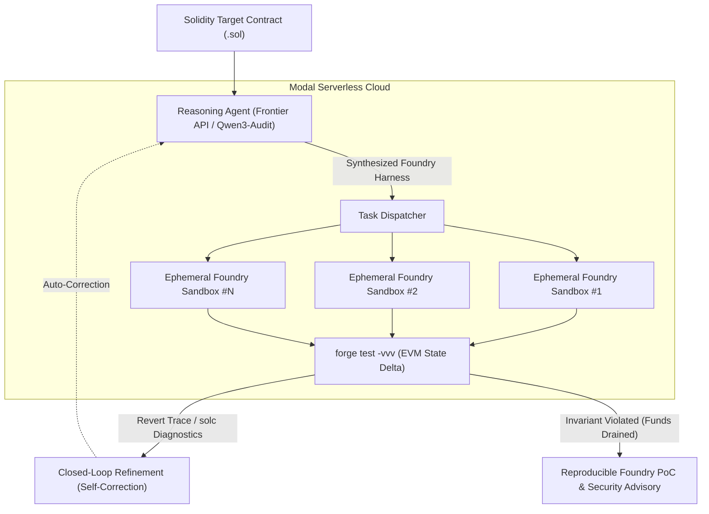

# Aegis-RLVR: Autonomous Web3 Smart Contract Security Framework

[](https://modal.com)
[](https://getfoundry.sh)
[](https://opensource.org/licenses/MIT)
[](#research-overview)

**Aegis-RLVR** is an autonomous smart contract security and exploit synthesis pipeline designed to eliminate False Positives in Web3 audits. It couples Large Language Model reasoning with **Reinforcement Learning from Verifiable Rewards (RLVR)** and distributed, ephemeral **Foundry / EVM execution sandboxes** running on Modal Cloud.

---

## 🔬 Research Overview & Problem Statement

Conventional coding benchmarks (SWE-bench, HumanEval) evaluate generic Python/JS coding proficiency, which does **not** correlate with the ability to detect and exploit subtle EVM vulnerabilities (e.g. storage collisions, reentrancy vectors, flash loan oracle manipulation).

### The Solution: Verifiable EVM Invariant Feedback
Aegis-RLVR closes the execution loop directly inside a sandboxed EVM:
1. **Frontier Reasoning / Local Auditor:** Synthesizes exploit hypotheses and generates self-contained Foundry test harnesses (`Exploit.t.sol`).
2. **Ephemeral Foundry Sandboxes (Modal):** Automatically builds contracts via `solc 0.8.20` and runs `forge test -vvv` in isolated Linux containers.
3. **Deterministic RLVR Rewards:** 
   - `[PASS]` on exploit execution + invariant breach = **+1.00 Reward (Verified 0-day)**
   - Compiler or revert failure = **-0.50 Penalty (with trace fed back for auto-refinement)**
   - Safe run without breach = **-0.10 Penalty**



---

## ⚡ Architectural Division of Labor on Modal

- **Modal GPU Workers:** Hosts specialized domain-specific audit models (e.g., `qtum/Qwen3-Coder-30B-A3B-Audit` on H100 80GB via vLLM) for private, on-premise vulnerability scanning.
- **Modal CPU Workers:** Runs ephemeral, parallel **Foundry + Anvil + Slither** environments with sub-second spin-up and zero idle costs.

---

## 📁 Repository Structure

```
D:\AI\Agentic-security-RLVR/
├── core/
│   ├── config.py           # Modal resources, model checkpoints, RLVR rewards
│   ├── schemas.py          # Pydantic schemas for contracts, hypotheses, verdicts
│   ├── llm_generator.py    # Foundry exploit synthesis & refinement prompts
│   └── evaluator.py        # EVM execution trace & verifiable reward evaluation
├── sandbox/
│   └── runner.py           # Modal Foundry / Anvil container image & execution
├── benchmarks/
│   └── targets/solidity/   # Vulnerable contract benchmarks (Damn Vulnerable DeFi)
│       └── Vault.sol
├── modal_app.py            # Primary Modal orchestration pipeline
├── requirements.txt
└── README.md
```

---

## 🚀 Running the Pipeline on Modal

### Prerequisites
```bash
pip install modal
modal profile activate neubeginner
```

### Execution
To run the automated EVM exploit synthesis and verification pipeline:
```bash
modal run modal_app.py
```

---

## 📄 License
This project is licensed under the MIT License - see the LICENSE file for details.
